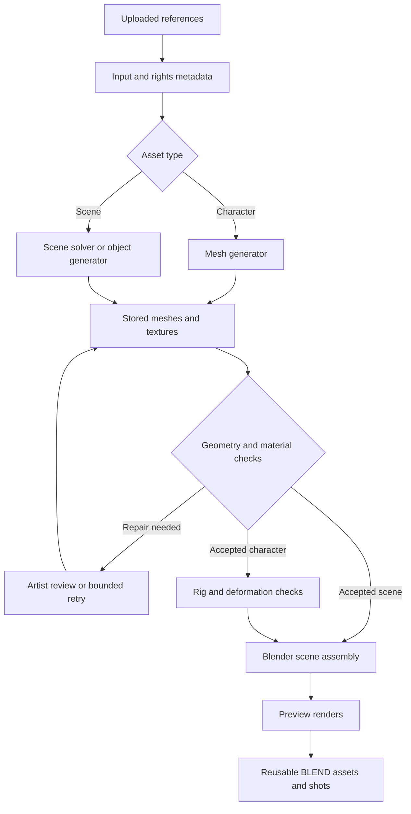

# Image to 3D for Blender: research report and production roadmap

**Research date: 8 November 2026.** Scope: full-body people, editable environments and an automated Blender movie pipeline. Prices are in the vendor’s displayed currency, before unverified tax/FX/payment charges. This is a public-source technical review, not a hands-on asset benchmark.

## Part 1 — What I would choose

**For your first full-body-photo experiment, start with Meshy and compare one paid Tripo result. For one-image generated scenery, start with Marble Pro’s high-quality textured mesh. For an actual room or street you can photograph, use multiview photogrammetry first.** These are workflow recommendations based on documented capabilities, not measured visual-quality winners.

| Your question | Practical answer | Important limit |
|---|---|---|
| Best starting website for a full-body photo | [Meshy](https://www.meshy.ai/) | Documents poses, multiview, rigging and native `.blend` export. Test face, fingers and deformation. |
| Alternative with production tools and clear API costs | [Tripo](https://www.tripo3d.ai/) | Segmentation/retopology/rigging are available; a generated talking face still needs work. |
| Best website shortlist for one-image environment generation | [World Labs Marble Pro](https://marble.worldlabs.ai/) | Request **HQ textured GLB**, not a collider or only a splat. Clean separate furniture is not guaranteed. |
| Closest commercial claim to separate image-derived scene objects | [Hyper3D WorldGen](https://hyper3d.ai/features/worldgen) | Exact Blender scene export and WorldGen pricing were not settled by reviewed public docs. Test an exported sample first. |
| Best free real-scene workflow | [RealityScan desktop](https://www.realityscan.com/license?lang=en-US) when revenue-eligible; [KIRI Engine Basic](https://www.kiriengine.app/pricing) for web/mobile | Requires many real views, a static scene and cleanup. |
| Best free/open local starting points | [TripoSR](https://github.com/VAST-AI-Research/TripoSR) for a simple permissive baseline; [TRELLIS.2](https://github.com/microsoft/TRELLIS.2) for a 24 GB+ GPU shortlist; [Meshroom](https://alicevision.org/) for multiview scenes | Free software/weights do not make GPU compute, capture or artist time free. |
| Most useful paid realistic-actor pipeline | [Character Creator 5 + Headshot 3](https://www.reallusion.com/character-creator/headshot/) plus Blender | Reconstructs/customizes a head and structured character. It does not automatically scan the full photographed outfit. |
| Can one image generate a complete mesh **and** rig? | **Yes, as generation.** Hosted rigging workflows and research such as [AniGen](https://github.com/VAST-AI-Research/AniGen) address this. | This does not establish an accurate digital double, clean facial rig, correct unseen surfaces or production-ready clothing. |
| Can one image give an editable environment? | **Partly yes.** Mesh exports and structured object/scene research exist. | No reviewed evidence guarantees a complete, metrically correct, separately editable arbitrary environment from any single photo. |

The key source checks for these choices are [Meshy generation](https://docs.meshy.ai/en/webapp/image-to-3d), [Meshy exports](https://docs.meshy.ai/en/webapp/guides/platform/export-formats), [Tripo’s image workflow](https://www.tripo3d.ai/features/image-to-3d-model), [Marble mesh export](https://docs.worldlabs.ai/marble/export/mesh), and [WorldGen’s scene claims](https://hyper3d.ai/features/worldgen).

### What is physically missing from a single picture

A front photograph contains no observation of the person’s back, the hidden side of their shoes, or the body under their coat. A room image does not show the wall behind the camera or the back of furniture. AI can infer plausible surfaces, and body/scene priors can constrain the guesses, but they do not turn missing observations into measured ground truth. Human-reconstruction papers such as [PSHuman](https://penghtyx.github.io/PSHuman/) explicitly treat this as an ill-posed reconstruction problem.

Four AI-generated reference views from one photo can help a generator remain visually consistent. They still contain **one photograph’s worth of observed evidence**. Four actual consistent camera views provide additional observations. Even actual multiview reconstruction has calibration, scale, occlusion and capture errors.

### The three outputs you should keep separate

| Output | What Blender can do | What it does not establish |
|---|---|---|
| Textured polygon mesh | Select vertices/faces, sculpt, edit UV/materials, add modifiers and rig | Good edge flow, complete anatomy, separate clothes or a ready facial rig |
| Structured character/scene | Work with named objects, armatures, weights and possibly blendshapes | Accurate likeness or exact reconstruction of unseen source content |
| Gaussian splat / NeRF | Render captured or generated appearance through a compatible pipeline; use for backgrounds | Ordinary polygon Edit Mode, complete object surfaces, physical materials or reliable independent furniture edits |

A `.blend` file is a project container. It can contain meshes, point clouds or procedural representations. The extension alone does not prove editability. Conversely, a good GLB/FBX/OBJ can be imported and saved as `.blend` without losing the fact that it is editable mesh geometry.

### Research coverage and evidence labels

The directory contains **75 entries: 59 generation/reconstruction/capture candidates, 13 supporting pipeline tools and 3 legacy/status checks**. Model versions are grouped into families; supporting tools and retired products are not counted as additional image-to-3D generators.

- **D — Documentation-verified:** a first-party manual, repository, schema or price page describes the capability. This does not mean an output was tested here.
- **A — Author demonstration:** the project/vendor publishes examples or a technical experiment. It establishes an illustrated possibility, not independent reliability.
- **I — Independent report/demonstration:** a third-party creator or user describes their own test. Sponsor, input and version limitations still apply.
- **V — Vendor-claimed:** relevant marketing language without sufficient exported-asset verification.
- **U — Unverified:** not resolved, inaccessible or not tested. This is deliberately different from “No.”

I reviewed official documentation, APIs, pricing, research implementations, export guides, selected creator descriptions and firsthand user reports. No generation account was used, no credits were purchased, and no generated asset was downloaded/imported/rigged during this review. The environment had neither a Blender executable nor `bpy`, so the requested hands-on Blender tests could not be performed. YouTube page access was throttled for several examples; indexed descriptions and documented chapters are labeled accordingly. The source review and first complete deliverables took approximately 40 minutes. A 3–4-hour hands-on test campaign was not performed.

## Part 2 — Full discovery directory

The following directory gives a compact screening view. The accompanying workbook preserves the fuller fields: delivery, single/multi-image support, human/environment scope, representation, rig, object separation, API/CLI, local requirements, rights, price and source links. “Reachable” refers to public documentation, not a successful generation/login test.


### Hosted generation and production services

| Tool | Input | Output / representation | Blender usefulness / limitation | Cost / access | Status / source |
|---|---|---|---|---|---|
| G01 [Meshy](https://www.meshy.ai/) | One subject; 1–4 views | BLEND, GLB, FBX, OBJ, USDZ, STL, 3MF, DXF. Polygon mesh | Strong starting website for characters and props; a generated mesh still needs deformation checks | Pro $20/month; 1,000 web-plan credits. Free: 100/month; download policy conflicts noted in report | Product documentation reachable. [Evidence](https://docs.meshy.ai/en/webapp/image-to-3d) |
| G02 [Tripo AI](https://www.tripo3d.ai/) | Single image; multiview references | GLB, FBX, OBJ and conversion options. Polygon mesh | Useful character tooling, segmentation and rigging; website pricing/licensing pages conflict | Studio Pro $20/month displayed. API standard textured image generation $0.30; rig $0.25 | Product documentation reachable. [Evidence](https://www.tripo3d.ai/features/image-to-3d-model) |
| G03 [Hyper3D Rodin](https://hyper3d.ai/) | 1–5 images or text | GLB, FBX, OBJ, USDZ, STL. Polygon mesh | Detailed assets with topology/material controls; no verified identity-quality advantage | Creator $30/month or $288/year. Business API tier $120/month or $1,152/year | Product documentation reachable. [Evidence](https://docs.hyper3d.ai/en/api-specification/rodin-gen2-5) |
| G04 [Hyper3D ChatAvatar](https://hyper3d.ai/features/chatavatar?lang=en) | Portrait, concept reference or text | Avatar package; general Hyper3D mesh formats; per-workflow rig export not verified. Polygon mesh | Dedicated face/body avatar package; source-photo clothing fidelity unproven | Preview available; per-asset commercial licence or Business entitlement; exact individual fee not verified | Product documentation reachable. [Evidence](https://hyper3d.ai/features/chatavatar?lang=en) |
| G05 [Hyper3D WorldGen](https://hyper3d.ai/features/worldgen) | Scene image or selected image regions | Scene export documented; exact downloadable scene format not verified. Polygon mesh | Promising independent editable objects; require an exported sample before selecting it for Blender production | WorldGen-specific pricing not verified | Product documentation reachable. [Evidence](https://hyper3d.ai/features/worldgen) |
| G06 [Hi3D / Hitem3D](https://www.hitem3d.ai/) | Single image and multiview; portrait modes | Downloadable mesh; exact format set not verified in reviewed docs. Polygon mesh | Useful high-detail figurines and portrait assets; no verified complete character rig | 100 lifetime free credits shown; paid subscriptions/credit packs. Cash price not reliably extracted | Product documentation reachable. [Evidence](https://platform.hitem3d.ai/console/resource/index) |
| G07 [3D AI Studio](https://www.3daistudio.com/) | Single and multiple images; model-dependent | GLB, FBX, OBJ, STL, USDZ, 3MF. Polygon mesh | Convenient model comparison and tooling; backend capabilities and billing must be checked separately | Subscriptions and trial credits; exact cash amounts not reliably readable | Product documentation reachable. [Evidence](https://www.3daistudio.com/) |
| G08 [Kaedim](https://www.kaedim3d.com/) | Image, sketch, reference pack or production brief | Production asset delivery; exact format/rig scope by brief. Polygon mesh | Potential route to usable topology through artist assurance; not pure one-click reconstruction | Indie $400/month: up to 20 geometries OR 1 complete retopologized UV-textured asset | Product documentation reachable. [Evidence](https://www.kaedim3d.com/faq) |


### Local object and structured-asset models

| Tool | Input | Output / representation | Blender usefulness / limitation | Cost / access | Status / source |
|---|---|---|---|---|---|
| L01 [TRELLIS family / TRELLIS.2](https://github.com/microsoft/TRELLIS.2) | Single object image; legacy TRELLIS multiview differs | PBR textured mesh / GLB pipeline. Polygon mesh | Best first local general-asset shortlist for a 24 GB+ NVIDIA workstation; not an automatic human rigger | Code/model licence free; GPU, setup and storage extra | Research code and weights released. [Evidence](https://github.com/microsoft/TRELLIS.2/blob/main/README.md) |
| L02 [Hunyuan3D family / 2.1 local](https://github.com/Tencent-Hunyuan/Hunyuan3D-2.1) | Image-to-shape then image/mesh-to-PBR texture | Textured mesh / GLB. Polygon mesh | Strong local asset alternative; GPU and territorial licence constraints matter | No model subscription for local release; GPU extra | Research code and weights released. [Evidence](https://github.com/Tencent-Hunyuan/Hunyuan3D-2.1/blob/main/README.md) |
| L03 [Stable Fast 3D](https://github.com/Stability-AI/stable-fast-3d) | Single object image; multiple paths are a batch | UV-unwrapped textured GLB. Polygon mesh | Lower-memory baseline; no full-body identity or rig guarantee | Free within Community Licence conditions; compute extra | Research code and weights released. [Evidence](https://github.com/Stability-AI/stable-fast-3d) |
| L04 [SPAR3D](https://github.com/Stability-AI/stable-point-aware-3d) | Single image plus editable point-cloud conditioning | Textured mesh. Polygon mesh | Point conditioning helps control unseen shape; still inferred, not measured | Free within model licence conditions; compute extra | Research code and weights released. [Evidence](https://github.com/Stability-AI/stable-point-aware-3d) |
| L05 [TripoSR](https://github.com/VAST-AI-Research/TripoSR) | Single object image; batch paths supported | Mesh; vertex colors or optional baked texture. Polygon mesh | Simple permissive local baseline; expect modest face/hands and manual rigging | Free model/code; compute extra | Research code and weights released. [Evidence](https://github.com/VAST-AI-Research/TripoSR) |
| L06 [TripoSG](https://github.com/VAST-AI-Research/TripoSG) | Single image | High-fidelity shape mesh; texture not established as included. Polygon mesh | Geometry-focused; add texturing and rigging separately | Free local release; compute extra | Research code and weights released. [Evidence](https://github.com/VAST-AI-Research/TripoSG) |
| L07 [InstantMesh](https://github.com/TencentARC/InstantMesh) | Single object image; internally generated views | OBJ; GLB demo; optional texture-map export. Polygon mesh | Useful older baseline; generated views do not add measured backside evidence | Free local release; compute extra | Research release; current maintenance not established. [Evidence](https://github.com/TencentARC/InstantMesh) |
| L08 [Wonder3D](https://github.com/xxlong0/Wonder3D) | Single object image | Multiview normals/colors, then textured mesh reconstruction. Polygon mesh | The simple demo only generates views; run reconstruction for an actual mesh | Free local release; compute extra | Research release; maintenance not established. [Evidence](https://github.com/xxlong0/Wonder3D/blob/main/gradio_app_mv.py) |
| L09 [Unique3D](https://github.com/AiuniAI/Unique3D) | Single object image | Textured mesh. Polygon mesh | Alternative research generator; online demo availability and export entitlement not tested | Local compute; hosted demo trial conditions not verified | Research code released; demo not tested. [Evidence](https://github.com/AiuniAI/Unique3D) |
| L10 [Hi3DGen](https://github.com/ByteDance/Hi3DGen) | Single image via normal-map bridging | Geometry mesh. Polygon mesh | Fine geometry research; no verified built-in complete PBR character/rig | Free local release; compute extra | Research release, ICCV 2025. [Evidence](https://github.com/bytedance/Hi3DGen/blob/main/README.md) |
| L11 [OpenLRM](https://github.com/3DTopia/OpenLRM) | Single object image | Reconstruction model; mesh extraction workflow. Polygon mesh | Older learning/research baseline; not a finished character workflow | Free local release; compute extra | Research release; current maintenance not established. [Evidence](https://github.com/3DTopia/OpenLRM) |
| L12 [LGM](https://github.com/3DTopia/LGM) | Image; multiview-conditioned generation | Gaussian representation; separate mesh-extraction route. Gaussian model plus optional extracted mesh | Select mesh path for Edit Mode; a Gaussian PLY alone has no mesh faces | Free local release; compute extra | Research release, ECCV 2024. [Evidence](https://github.com/3DTopia/LGM) |
| L13 [PartCrafter](https://github.com/wgsxm/PartCrafter) | Single RGB image; requested part count | Multiple part/object meshes; scene variant. Polygon mesh | Useful for separated geometry; do not assume finished textures, joints or correct room completion | Free local release; compute extra | Research code and scene version released. [Evidence](https://github.com/wgsxm/PartCrafter/blob/main/README.md) |
| L14 [SAM 3D Objects](https://github.com/facebookresearch/sam-3d-objects) | Single scene image and instance masks | Textured GLB meshes; Gaussian PLY; pose/layout. Mesh and Gaussian outputs; use the mesh branch | Strong research match for separate scene props; room shell and hidden details still need work | No model subscription; gated weights and GPU extra | Research code, weights and online demo released. [Evidence](https://github.com/facebookresearch/sam-3d-objects) |
| L15 [PartPacker](https://github.com/NVlabs/partpacker) | Single image | Part-level geometry. Polygon mesh | Parts are useful for editing; not a rigged textured human or complete-room guarantee | Free research release; compute extra | Research code released. [Evidence](https://github.com/nvlabs/partpacker) |


### Human reconstruction and avatar tools

| Tool | Input | Output / representation | Blender usefulness / limitation | Cost / access | Status / source |
|---|---|---|---|---|---|
| H01 [Character Creator 5 + Headshot 3](https://www.reallusion.com/character-creator/headshot/) | Portrait photo, optional mesh; body/outfit customization | FBX character; Blender Auto Setup workflow. Polygon mesh | Strong production route to a recognizable head on an editable rigged body; does not scan the photographed outfit/body | CC5 list $299; Headshot 3 list $199; bundles/member offers vary; final checkout not verified | Product documentation reachable. [Evidence](https://manual.reallusion.com/Headshot_Plugin/ENU/3.0/04-Image-Mode/Introduction-of-Image-Mode.html) |
| H02 [Avatar SDK / MetaPerson](https://avatarsdk.com/) | Front-facing selfie | GLB / FBX; rigged customizable avatar. Polygon mesh | Recognizable face plus generated/preset full body; not faithful full-body clothing reconstruction | First creator avatar export free; Pro integration $800/month for 6,000 avatars; REST eligibility conflicts noted | Product documentation reachable. [Evidence](https://avatarsdk.com/avatars/) |
| H03 [Avaturn](https://avaturn.me/) | Selfie plus body/outfit customization | Exportable 3D avatar; GLB integration workflow. Polygon mesh | Fast animation-ready likeness; photographed outfit and hidden body are not reconstructed | Creator/export trial conditions not fully verified; developer Pro $800/month, 1,000 avatars | Product documentation reachable. [Evidence](https://avaturn.me/) |
| H04 [KeenTools FaceBuilder](https://keentools.io/products/facebuilder-for-blender) | One or several face photographs | Native Blender head mesh, textures and facial blendshapes. Polygon mesh | Useful face-likeness control inside Blender; head-only, attach a body and rig separately | 15-day trial; subscription amount not verified from official pricing | Product documentation reachable. [Evidence](https://keentools.io/products/facebuilder-for-blender) |
| H05 [PSHuman](https://github.com/pengHTYX/PSHuman) | Single full-body image | Textured human mesh. Polygon mesh | Human-specific face/body multiview generation; backside remains inferred and rig is a separate task | No model subscription; compute extra | Research code released; SMPL-free variant noted. [Evidence](https://penghtyx.github.io/PSHuman/) |
| H06 [ECON](https://github.com/YuliangXiu/ECON) | Single color image; multi-person support | Clothed human mesh / OBJ workflow. Polygon mesh | Useful reconstruction with loose clothes; SMPL-X animation demonstration is not a complete cinematic face rig | Free for non-commercial scientific research; commercial licence requires contact | Research release; Blender/Colab integrations linked. [Evidence](https://github.com/YuliangXiu/ECON) |
| H07 [ICON](https://github.com/YuliangXiu/ICON) | Single RGB image | OBJ clothed human / body; optional masked garment extraction. Polygon mesh | Older human-specific baseline; not a finished textured rigged actor | Non-commercial scientific research; compute extra | Research release; maintenance not established. [Evidence](https://github.com/YuliangXiu/ICON) |
| H08 [PIFuHD](https://github.com/facebookresearch/pifuhd) | Single full-body image | Human surface mesh; texture/rig not established as complete. Polygon mesh | Historical geometry baseline; unsuitable as the default current film-production recommendation | Research use under CC BY-NC 4.0; compute extra | Legacy research release. [Evidence](https://github.com/facebookresearch/pifuhd) |
| H09 [TeCH](https://github.com/huangyangyi/TeCH) | Single full-body image and derived text descriptions | Textured OBJ. Polygon mesh | Detailed human research pipeline; computationally heavy and needs licence review | Compute extra; API/token dependencies may add costs | Research release, 3DV 2024. [Evidence](https://github.com/huangyangyi/TeCH) |
| H10 [SiTH](https://github.com/SiTH-Diffusion/SiTH) | Single human RGBA image plus body fitting | Fully textured human mesh. Polygon mesh | Explicit back hallucination; research animation demo does not establish production topology | No model subscription; compute extra; commercial rights not verified | Research code and weights released. [Evidence](https://github.com/SiTH-Diffusion/SiTH) |
| H11 [PuzzleAvatar](https://github.com/YuliangXiu/PuzzleAvatar) | Unconstrained photo collection | Textured clothed human mesh. Polygon mesh | Uses multiple real photos, but differing poses/outfits and hallucinated hidden detail remain concerns | Non-commercial research; published full pipeline around 4 hours on authors’ setup | Research code released; successor UP2You linked. [Evidence](https://github.com/YuliangXiu/PuzzleAvatar/blob/main/README.md) |
| H12 [UP2You](https://github.com/zcai0612/UP2You) | Unconstrained human photos | Textured clothed human mesh. Polygon mesh | Newer tuning-free alternative to PuzzleAvatar; orthogonal views are inferred from the photo set | No model subscription; compute extra; non-commercial checkpoint licence | Research code/weights released, ICLR 2026. [Evidence](https://zcai0612.github.io/UP2You/) |
| H13 [HumanNOVA](https://github.com/HumanNOVA/HumanNOVA) | Single human image | Rendered outputs and meshes; exact interchange format not verified. Polygon mesh | Newer human-specific model worth evaluating; output rig and commercial licence remain unresolved | No listed subscription; GPU and dependency costs extra | Inference code released May 2026. [Evidence](https://github.com/HumanNOVA/HumanNOVA) |
| H14 [AniGen](https://github.com/VAST-AI-Research/AniGen) | Single image; optional video fitting extension | GLB asset with mesh, skeleton and skin weights. Polygon mesh | Directly targets image-to-rigged-asset; identity, facial rigging and wardrobe separation unproven | No model subscription; GPU extra; dependency licensing needs review | Research code, checkpoints and Gradio demo released. [Evidence](https://github.com/VAST-AI-Research/AniGen) |
| H15 [SAM 3D Body](https://github.com/facebookresearch/sam-3d-body) | Single image, optional keypoints/masks | MHR parametric body mesh and pose. Polygon mesh | Useful body/hand/foot pose recovery; not a reconstruction of textured clothing, hair and identity | No model subscription; gated weights and compute extra | Research code, weights and demo released. [Evidence](https://github.com/facebookresearch/sam-3d-body) |
| H16 [Vid2Avatar](https://github.com/MoyGcc/vid2avatar) | Monocular person video plus preprocessing | Canonical human mesh and deformed mesh sequence. Polygon mesh | A video-specific route; not an instant website or a ready facial/wardrobe rig | Research compute; author states 24–48 hours training; rights not verified | Legacy research implementation. [Evidence](https://github.com/MoyGcc/vid2avatar) |


### Scene and world-generation models

| Tool | Input | Output / representation | Blender usefulness / limitation | Cost / access | Status / source |
|---|---|---|---|---|---|
| E01 [World Labs Marble](https://marble.worldlabs.ai/) | Single/multiple images, 360 panorama, video, text or 3D blockout | SPZ/PLY splats; collider GLB; high-quality textured/vertex-color GLBs. Gaussian world plus derived meshes | Best documented commercial starting point for a generated scene mesh; semantic furniture separation not guaranteed | Standard $20/month; Pro $35/month for textured mesh export and commercial rights | Product documentation reachable. [Evidence](https://docs.worldlabs.ai/marble/export/mesh) |
| E02 [HunyuanWorld / HY-World family](https://github.com/Tencent-Hunyuan/HY-World-2.0) | Single/multiple images, text and video; version-dependent | Mesh and/or Gaussian world representations. Meshes / Gaussians; inspect selected branch | Promising research world generation; 1.0 semantic layers are not a guaranteed complete object inventory | No model subscription; substantial GPU/dependency costs | Research code/weights released; hosted 2.1 product linked. [Evidence](https://github.com/Tencent-Hunyuan/HY-World-2.0) |
| E03 [Mira-Scene](https://github.com/VAST-AI-Research/Mira-Scene) | Single scene image, instance segmentation/depth stages | Scene GLB with per-object mesh generation. Polygon mesh | Strong architectural match to editable scenes; full source-image fidelity not independently established | No model subscription; selected backends/GPU extra | Research inference, checkpoints and example cases released. [Evidence](https://github.com/VAST-AI-Research/Mira-Scene) |
| E04 [3D-RE-GEN](https://github.com/cgtuebingen/3D-RE-GEN) | Single indoor image | Textured object/background assets and assembled scene; exact export list unverified. Polygon mesh | Good research candidate for separate props, reconstructed background and lighting | No wrapper subscription; GPU/backend costs extra | Research implementation released. [Evidence](https://github.com/cgtuebingen/3D-RE-GEN) |
| E05 [WorldBuilder](https://github.com/AdamRolander/WorldBuilder) | Single room photo | Named textured object GLBs, room shell, Blender add-on. Polygon mesh | Very close to requested scene workflow, but early project with limited independent evidence | Local compute; optional cloud detector costs extra | Early experimental project; limited independent evidence. [Evidence](https://github.com/AdamRolander/WorldBuilder) |


### Photogrammetry and scanning

| Tool | Input | Output / representation | Blender usefulness / limitation | Cost / access | Status / source |
|---|---|---|---|---|---|
| P01 [RealityScan desktop / mobile](https://www.realityscan.com/) | Overlapping photos; supported scans / video frames | OBJ, GLB, FBX, PLY, USD/USDZ, STL and others. Polygon mesh | Best free desktop shortlist for observed geometry when eligible; scans usually need semantic remodeling | Free below $1M annual gross revenue; otherwise $1,250/seat/year | Product documentation reachable. [Evidence](https://rshelp.capturingreality.com/en-US/tools/export.htm) |
| P02 [KIRI Engine](https://www.kiriengine.app/) | Photo sets, room/LiDAR capture, supported video/3DGS modes | OBJ, FBX, GLB/GLTF, STL, USDZ, PLY/XYZ; mode-dependent. Mesh or Gaussian output depending on capture mode | Strong free online/phone route to real mesh; 3DGS-to-mesh is a separate conversion | Basic free, unlimited exports, up to 150 photos/scan; Pro $17.99/month or $79.99/year | Product documentation reachable. [Evidence](https://www.kiriengine.app/features/export-formats) |
| P03 [Polycam](https://poly.cam/) | Photo set; LiDAR/non-LiDAR space capture; Gaussian modes | Free GLTF; paid OBJ/FBX/GLTF/STL/USDZ/DAE and others. Mesh / point cloud / Gaussian by mode | Convenient capture-to-Blender; full-scene mesh is usually scan geometry, not clean furniture hierarchy | Free limited captures + GLTF; Basic $30/month or $150/year; Business $400/user/year | Product documentation reachable. [Evidence](https://learn.poly.cam/hc/en-us/articles/27756102599572-What-File-Types-Can-Polycam-Export) |
| P04 [Agisoft Metashape](https://www.agisoft.com/) | Overlapping photographs; professional sensor workflows | OBJ, FBX, GLB and other mesh formats in reviewed 2.2 Standard manual. Polygon mesh | Strong paid reconstruction shortlist for actual observed locations; no automatic semantic remodeling | Standard $179; Professional $3,499 node-locked, displayed official store | Product documentation reachable. [Evidence](https://www.agisoft.com/pdf/metashape_2_2_en.pdf) |
| P05 [Meshroom / AliceVision](https://alicevision.org/) | Overlapping photographs | UV-textured mesh / OBJ workflow. Polygon mesh | Best open-source GUI shortlist for photogrammetry; capture quality controls accuracy | Free open-source software; hardware/compute extra | Public desktop project and binaries. [Evidence](https://alicevision.org/) |
| P06 [3DF Zephyr](https://www.3dflow.net/3df-zephyr-free/) | Overlapping photos / supported video workflow | Free textured OBJ / PLY; paid features differ. Polygon mesh | Accessible learning tool; Free edition is explicitly personal use, not default for monetized films | Free personal edition up to 50 photos; paid editions/prices not verified | Product documentation reachable. [Evidence](https://www.3dflow.net/3df-zephyr-free/) |
| P07 [Scaniverse / Niantic Spatial](https://scaniverse.com/) | Mobile capture; paid supported 360-camera video | Mesh FBX/GLB; Gaussian SPZ/PLY; plan-dependent. Mesh and/or Gaussian; choose correct asset type | Current platform has cloud credits; older unlimited-free descriptions apply to legacy processing | Current Free: 20,000 credits/month; Plus $20/month or $200/year; scope differs from legacy app | Product documentation reachable. [Evidence](https://www.nianticspatial.com/pricing) |
| P08 [COLMAP](https://colmap.github.io/) | Overlapping photographs | Camera poses, dense PLY, surface meshes; texturing route in current docs. Sparse/dense points and optional mesh | Developer-friendly reconstruction base; a sparse point cloud alone is not Blender mesh geometry | Free software; compute extra | Open-source project; current docs reachable. [Evidence](https://colmap.github.io/tutorial) |
| P09 [OpenMVS](https://github.com/cdcseacave/openMVS) | Camera poses + sparse reconstruction + source photos | Refined textured mesh; PLY/OBJ/GLB routes version-dependent. Polygon mesh | Useful dense reconstruction stage after SfM; not a single-photo scene generator | Free code; compute extra | Open-source research/developer project. [Evidence](https://github.com/cdcseacave/openMVS) |


### Radiance fields and geometry conversion

| Tool | Input | Output / representation | Blender usefulness / limitation | Cost / access | Status / source |
|---|---|---|---|---|---|
| R01 [Postshot](https://www.jawset.com/) | Photos/video; camera poses as supported | PLY/SPZ Gaussian radiance fields; cameras/points. Gaussian splats / radiance fields | Useful background capture; ordinary PLY import does not turn splats into mesh faces | Free non-commercial, no radiance-field export; Indie €17/month billed €204/year; Studio €39/month billed annually | Product documentation reachable. [Evidence](https://activation.jawset.com/docs/d/Postshot%2BUser%2BGuide/Interface/Radiance%2BField%2BExport) |
| R02 [Nerfstudio](https://docs.nerf.studio/) | Multiview photos/video and camera processing | NeRF checkpoints; Gaussian PLY; extracted textured OBJ. Model-dependent NeRF / splat / mesh | Capable local research stack; choose NeRF/normal/TSDF path appropriate for mesh export | Free framework; GPU extra | Open-source framework. [Evidence](https://docs.nerf.studio/quickstart/export_geometry.html) |
| R03 [Original 3D Gaussian Splatting](https://github.com/graphdeco-inria/gaussian-splatting) | Posed multiview images | Gaussian PLY representation. Gaussian splats | Reference implementation for research; not directly editable polygon scenery | Research/evaluation licence; commercial licensing separate; compute extra | Research reference implementation. [Evidence](https://github.com/graphdeco-inria/gaussian-splatting/blob/main/LICENSE.md) |
| R04 [SuGaR](https://github.com/Anttwo/SuGaR) | Multiview reconstruction and trained Gaussian scene | Surface-aligned Gaussians and textured mesh. Hybrid surface mesh + Gaussians | Actual mesh-extraction and Blender editing route; conversion still has geometry/material limits | Research compute; all code/dependency commercial rights not fully verified | Research implementation and Blender add-on. [Evidence](https://github.com/Anttwo/SuGaR/blob/main/README.md?plain=1) |
| R05 [DN-Splatter / AGS-Mesh](https://github.com/maturk/dn-splatter) | Posed multiview imagery; depth/normal priors | Gaussian scene and extracted mesh/PLY. Gaussian plus explicit mesh extraction | Useful meshing stage, including TSDF options; not a complete one-photo editable-room service | Free research code; compute extra; commercial component rights not verified | Research implementation. [Evidence](https://github.com/maturk/dn-splatter) |
| R06 [Apple SHARP](https://github.com/apple-aiml-research/ml-sharp) | Single scene image | Gaussian PLY; nearby-view rendering. Gaussian splats | Useful nearby-view parallax research; not a complete mesh room or freely orbitable verified world | Research-only model; compute extra | Research code and model released. [Evidence](https://apple.github.io/ml-sharp/) |
| R07 [gsplat](https://github.com/nerfstudio-project/gsplat) | Gaussian parameters; reconstruction training integration | Rendered images and Gaussian data via chosen pipeline. Gaussian rasterization | Developer building block; not an image-to-mesh website | Free code; GPU extra | Open-source developer library. [Evidence](https://github.com/nerfstudio-project/gsplat) |


### Supporting Blender production tools

| Tool | Input | Output / representation | Blender usefulness / limitation | Cost / access | Status / source |
|---|---|---|---|---|---|
| S01 [Mixamo](https://www.mixamo.com/) | Existing clean humanoid mesh | Rigged FBX and animation downloads. Polygon mesh | Free guided body-rig/animation stage; no photo reconstruction or production facial rig | Free with Adobe ID | Product documentation reachable. [Evidence](https://helpx.adobe.com/creative-cloud/faq/mixamo-faq.html) |
| S02 [AccuRIG](https://www.reallusion.com/auto-rig/accurig/default.html) | Existing FBX/OBJ character mesh | Rigged FBX / USD. Polygon mesh | Guided rigging, including finger/joint adjustments; does not fix topology or reconstruct a photo | Standalone free tool; ActorCore motions/content may cost extra | Product documentation reachable. [Evidence](https://www.reallusion.com/auto-rig/accurig/default.html) |
| S03 [Rigify](https://docs.blender.org/manual/en/latest/addons/rigify/index.html) | Artist-fitted meta-rig and mesh | Native Blender control/deformation rig. Polygon mesh | Generates bones/controls; positioning and skinning still need a workflow | Free with Blender | Product documentation reachable. [Evidence](https://docs.blender.org/manual/en/latest/addons/rigify/introduction.html) |
| S04 [UniRig](https://github.com/VAST-AI-Research/UniRig) | Existing 3D mesh | Skeleton and predicted weights; FBX workflow. Polygon mesh | Local automatic rigging research; verify checkpoint completeness and material preservation | Free code; GPU/setup extra | Research release; staged checkpoint notes and successor linked. [Evidence](https://github.com/VAST-AI-Research/UniRig) |
| S05 [SkinTokens](https://github.com/VAST-AI-Research/SkinTokens) | Existing 3D asset | Unified skeleton/skinning prediction; final file support not verified. Polygon mesh | Newer UniRig successor; do not treat paper/repo presence as a proven ready installation | Free code; compute extra; weights/release completeness not fully verified | Experimental research release. [Evidence](https://github.com/VAST-AI-Research/SkinTokens) |
| S06 [Quad Remesher](https://exoside.com/) | Existing mesh | New quad mesh inside supported DCC. Polygon mesh | Automatic remeshing helps topology density; does not guarantee face/joint deformation loops or preserve UVs | Paid plugin; 1-month trial; official cash price not verified | Product documentation reachable. [Evidence](https://exoside.com/quadremesher/quadremesher-doc/) |
| S07 [Instant Meshes](https://github.com/wjakob/instant-meshes) | Existing mesh | Remeshed surface. Polygon mesh | Free interactive field-aligned remeshing; not InstantMesh image generation | Free software | Legacy open-source remesher. [Evidence](https://github.com/wjakob/instant-meshes) |
| S08 [RetopoFlow](https://retopoflow.com/) | Existing mesh; artist retopology | Editable retopologized Blender mesh. Polygon mesh | Useful manual topology control for a hero actor; it does not reconstruct or rig the photo | Paid distribution/support; GPL code; exact current price not verified | Product documentation reachable. [Evidence](https://docs.retopoflow.com/v4/installation.html) |
| S09 [Auto-Rig Pro](https://www.lucky3d.fr/auto-rig-pro/doc/) | Existing mesh and rig markers | Blender rig; FBX/GLTF export; retargeted animation. Polygon mesh | Practical Blender rigging/retargeting tool; still needs geometry and weights review | $50 full licence; optional updates renewal $12.50/year shown | Product documentation reachable. [Evidence](https://artell.gumroad.com/l/autorigpro) |
| S10 [fSpy](https://fspy.io/) | One perspective photograph and vanishing-line annotations | Camera calibration / .fspy; Blender importer. Camera parameters; no geometry | Good for matching a room photo before manual modeling; it generates no room mesh | Free open-source software | Product documentation reachable. [Evidence](https://fspy.io/) |
| S11 [Sweet Home 3D desktop](https://www.sweethome3d.com/) | Imported floor-plan image, manually traced walls and placed furniture | OBJ + MTL + texture images from desktop edition. Parametric walls/furniture exported as mesh | Reliable floor-plan-to-scene route with manual tracing; online/mobile OBJ export is unavailable | Free desktop software; stores/content packages can differ | Product documentation reachable. [Evidence](https://www.sweethome3d.com/users-guide/) |
| S12 [KIRI Gaussian Splatting Blender add-on](https://www.kiriengine.app/) | Existing Gaussian splat file | Splat rendering inside Blender. Gaussian rendering in Blender | A splat importer/renderer, not semantic mesh conversion or full relighting | Free plugin per World Labs integration docs | Product documentation reachable. [Evidence](https://docs.worldlabs.ai/marble/export/gaussian-splat/blender) |


### Legacy products and current-status checks

| Tool | Input | Output / representation | Blender usefulness / limitation | Cost / access | Status / source |
|---|---|---|---|---|---|
| X01 [Ready Player Me](https://readyplayer.me/) | Previously selfie avatar creation | Previously GLB avatars. Polygon mesh | Do not start a new dependency; integrators report service closure on 31 Jan 2026 | No current generation price applicable | Closure reported by integrating services; homepage fetch failed. [Evidence](https://learn.framevr.io/blog/rpm-closure) |
| X02 [CSM Cube](https://www.csm.ai/) | Previously image/sketch/text | Previously downloadable 3D assets. Polygon mesh | Homepage failed; retirement reported by third parties; exact shutdown notice not verified | Current pricing not verified | Unreachable in this review; discontinuation reported, not owner-verified. [Evidence](https://www.csm.ai/) |
| X03 [Luma 3D Capture / Genie](https://apps.apple.com/us/app/luma-3d-capture/id1615849914) | Capture app photos/video; Genie was text-to-3D | Capture exports may remain; current formats not reverified. Capture-mode dependent; do not assume mesh | App listing remains, but Genie sunset 1 Jan 2026; avoid relying on old Genie tutorials | App listed free; current end-to-end export entitlements not tested | Capture app listed; Genie explicitly sunset in release notes. [Evidence](https://apps.apple.com/us/app/luma-3d-capture/id1615849914) |


## Part 3 — Fifteen human solutions to evaluate

The order prioritizes practical suitability and documented handoff, then research alternatives. It is **not** a measured quality ranking. None received a numerical quality score without a common-input test. Each profile’s price/access and licence details are in its directory record and the pricing comparison in Part 5.


### 1. Meshy — Most practical first website to trial

**How it works / input:** Upload one isolated head-to-toe reference. For a human, prefer a neutral expression, clearly separated arms/legs, visible hands/feet and a simple background. Add actual front, side and back photos when available. Pose conversion changes the pictured pose; enhancement can also change design details.

**Output and Blender handoff:** BLEND, GLB, FBX, OBJ, USDZ, STL, 3MF, DXF. Import supported mesh; inspect materials and topology.

**Body, back, face and clothing:** A complete rotatable mesh can be generated, but face identity, five separated fingers, soles and the back of the outfit are not established by export support. Synthetic extra views are guesses. Smart Topology/Auto Split can help structure. Current docs say Split and Texture cannot be enabled together, so plan a separate texture stage when needed. Inspect joint and facial deformation before animation.

**Rig, topology and parts:** Humanoid rigging API; animated FBX/GLB/USDZ. Auto Split / Smart Topology documented; inspect result. REST, webhooks, Blender bridge.

**Price / rights:** See G01 in Part 2. Paid private assets; free CC BY 4.0. Non-enterprise training use may occur.

**Recommendation:** Use Meshy for a first character/prop trial and native Blender-file delivery. Treat the result as a starting actor asset. Facial animation and separate removable clothing need specific validation.

**Evidence:** [Generation / pose / views](https://docs.meshy.ai/en/webapp/image-to-3d), [Export formats](https://docs.meshy.ai/en/webapp/guides/platform/export-formats), [Rigging constraints](https://docs.meshy.ai/en/api/rigging). Documentation/author examples reviewed; no hands-on output test in this session.


### 2. Tripo AI — Strong alternative with documented production tools and API rates

**How it works / input:** Use one isolated person or a consistent multiview set. Current H-series docs support named front/left/back/right references. Test the H-series for surface detail and P-series for topology; an attractive turnaround is not a deformation test.

**Output and Blender handoff:** GLB, FBX, OBJ and conversion options. Import supported mesh; inspect materials and topology.

**Body, back, face and clothing:** Segmentation, Smart Mesh and rigging are documented capabilities. They do not establish exact body proportions or a clean talking face. The current humanoid rigging recommendation is v3.0-20260909; the API default still points at an older rigger, so choose the version explicitly.

**Rig, topology and parts:** Auto rig and animation; select compatible rigging version. Segmentation / generated parts documented. REST v3, webhooks, batch Studio workflow, DCC bridge.

**Price / rights:** See G02 in Part 2. Use a paid private workflow for commercial work. Free-use terms conflict.

**Recommendation:** A good paid trial alongside Meshy. For automated character generation it is my first implementation candidate because the public rate card separates generation, rigging and animation costs.

**Evidence:** [Image API](https://developers.tripo3d.ai/en/docs/generation-image-to-model/standard), [Multiview API](https://developers.tripo3d.ai/en/docs/generation-multiview-to-model/standard), [Rigging API](https://developers.tripo3d.ai/en/docs/animations-rig). Documentation/author examples reviewed; no hands-on output test in this session.


### 3. Hyper3D Rodin — Detailed mesh alternative with an important new rigging endpoint

**How it works / input:** Gen-2.5 accepts up to five images. Supply genuinely consistent viewpoints of the same person/outfit. Image order and chosen settings matter; use the current API schema rather than an old tutorial.

**Output and Blender handoff:** GLB, FBX, OBJ, USDZ, STL. Import supported mesh; inspect materials and topology.

**Body, back, face and clothing:** Rodin exposes triangle/quad and material controls. Its current API can rig generated assets or uploaded meshes. Uploaded-model rigging does not preserve embedded textures/materials automatically; a reference image may trigger regenerated texturing. No controlled evidence here establishes superior face resemblance or wardrobe separation.

**Rig, topology and parts:** Rigging endpoint now documented; uploaded-model textures need care. BANG splitting tool; not automatic semantic wardrobe guarantee. REST v2, polling, official DCC add-ons.

**Price / rights:** See G03 in Part 2. Rodin output use allowed subject to terms; ChatAvatar has separate rules.

**Recommendation:** Compare one exported character against Meshy/Tripo before committing. Preserve the original textured asset separately when evaluating the rigging route.

**Evidence:** [Gen-2.5](https://docs.hyper3d.ai/en/api-specification/rodin-gen2-5), [Rigging](https://docs.hyper3d.ai/en/api-specification/rigging), [Asset features](https://hyper3d.ai/ja/help/articles/what-features-does-hyper3d-have). Documentation/author examples reviewed; no hands-on output test in this session.


### 4. Character Creator 5 + Headshot 3 — Best production-oriented shortlist for a recognizable speaking character

**How it works / input:** Headshot reconstructs the head from a portrait or mesh within Character Creator. Customize the body, proportions, outfit and hair. This is especially useful when facial animation, reusable wardrobe and actor controls matter more than reproducing the photographed coat exactly.

**Output and Blender handoff:** FBX character; Blender Auto Setup workflow. Import supported mesh; inspect materials and topology.

**Body, back, face and clothing:** A structured body and face workflow makes editing and animation more tractable than a fused scan. It does not recover the unseen body or full outfit from the photograph. Head shape and texture still need artist refinement. Use Blender Auto Setup and inspect imported morphs/materials.

**Rig, topology and parts:** Structured body/facial rig and morph workflow. Customizable body, hair and wardrobe assets. Blender Auto Setup; unattended end-to-end API not verified.

**Price / rights:** See H01 in Part 2. Software/content/export licences apply; purchased wardrobe assets have their own terms.

**Recommendation:** My practical paid choice for a recurring realistic lead actor, subject to a likeness test. It is desktop software rather than the requested all-in-one website, and wardrobe/content/export licences add cost.

**Evidence:** [Headshot image mode](https://manual.reallusion.com/Headshot_Plugin/ENU/3.0/04-Image-Mode/Introduction-of-Image-Mode.html), [CC5 / Blender support](https://www.reallusion.com/iclone/3d-character.html), [Headshot FAQ](https://faq.reallusion.com/Product/Character-Creator/Plug-in/Headshot). Documentation/author examples reviewed; no hands-on output test in this session.


### 5. Avatar SDK / MetaPerson — Fast structured avatar with a recognizable face

**How it works / input:** Give MetaPerson a front-facing selfie, then customize the avatar. A full-body photograph is not needed. Select body, wardrobe and hairstyle deliberately rather than expecting the pictured full-body outfit to be scanned.

**Output and Blender handoff:** GLB / FBX; rigged customizable avatar. Import supported mesh; inspect materials and topology.

**Body, back, face and clothing:** Official sample avatars are provided in GLB and FBX with body/outfit specifications and animation support. The result is a structured avatar with a likeness-oriented face, not verified photographic body/clothing reconstruction. Realistic and cartoon variants are documented.

**Rig, topology and parts:** Rigged body; blendshapes. Body/hair/outfit components documented. SDK/embedded creator; REST tier eligibility must be confirmed.

**Price / rights:** See H02 in Part 2. Confirm creator-export commercial licence and integration terms.

**Recommendation:** Useful for a quick animated person or background cast. First creator export is free according to current pricing, but confirm its commercial licence. Do not buy the developer subscription just to obtain one actor.

**Evidence:** [Avatar types / samples](https://avatarsdk.com/avatars/), [Pricing](https://avatarsdk.com/pricing-cloud/), [REST access](https://docs.metaperson.avatarsdk.com/rest_api/). Documentation/author examples reviewed; no hands-on output test in this session.


### 6. Avaturn — Selfie-to-rigged-avatar option

**How it works / input:** Create a selfie-based avatar and customize its body, hair and catalog clothes. Avaturn advertises exports usable in Blender and other DCC applications. Follow the creator capture instructions; do not assume any arbitrary full-body photo is accepted as a full scan.

**Output and Blender handoff:** Exportable 3D avatar; GLB integration workflow. Import supported mesh; inspect materials and topology.

**Body, back, face and clothing:** The body rig, ARKit blendshapes and visemes are documented. These are useful for basic body and facial animation. They do not mean the original person’s back, body measurements, hairstyle geometry and clothing have all been measured from one image.

**Rig, topology and parts:** Humanoid body rig, ARKit blendshapes, visemes. Customizable catalog clothes, hair and body. API / SDK and embedded creator.

**Price / rights:** See H03 in Part 2. Creator/download rights and data retention not fully verified.

**Recommendation:** A practical alternative to MetaPerson for structured avatars. Verify the current creator export entitlement, shape-key transfer and film-use licence before using it for a recurring actor.

**Evidence:** [Product / animation](https://avaturn.me/), [Developer docs](https://docs.avaturn.me/), [Developer pricing](https://avaturn.dev/pricing/). Documentation/author examples reviewed; no hands-on output test in this session.


### 7. Hyper3D ChatAvatar — Avatar package with documented facial capabilities; verify purchased rights

**How it works / input:** Start from a portrait, character reference or text. The current product page describes detailed face geometry, a matching body and PBR materials, with expression, viseme and blendshape features.

**Output and Blender handoff:** Avatar package; general Hyper3D mesh formats; per-workflow rig export not verified. Exact exported mesh, body rig and facial package require a Blender trial.

**Body, back, face and clothing:** Those features address an important weakness of general mesh generators. However, exact body identity, photo-faithful clothes, a complete body control rig and the precise downloadable rig package were not independently checked. Treat “nearly production-ready” as a vendor claim.

**Rig, topology and parts:** Facial blendshapes, visemes and expressions vendor-documented. Matching body; separate outfit topology unverified. Rodin API does not establish ChatAvatar API access.

**Price / rights:** See G04 in Part 2. Unpurchased output personal/non-commercial under product terms; commercial licence required.

**Recommendation:** Worth testing for faces and dialogue. ChatAvatar has different output licensing from Rodin: unpaid output is described as personal/non-commercial; purchase the relevant commercial licence or confirm Business entitlement.

**Evidence:** [Product](https://hyper3d.ai/features/chatavatar?lang=en), [Product-specific terms](https://hyper3d.ai/legal/terms), [Plan entitlements](https://hyper3d.ai/pricing?lang=en). Documentation/author examples reviewed; no hands-on output test in this session.


### 8. AniGen — Most directly relevant research candidate for single-image mesh plus rig

**How it works / input:** AniGen jointly predicts shape, skeleton and skinning from an isolated image. The repository includes inference scripts, checkpoints, a Gradio interface and GLB output code. Optional video fitting is a separate extension.

**Output and Blender handoff:** GLB asset with mesh, skeleton and skin weights. Import supported mesh; inspect materials and topology.

**Body, back, face and clothing:** This establishes that a single-image pipeline can output both geometry and a rig. It does not establish accurate unseen anatomy, a recognizable moving face, clean clothing layers or reliable production deformation on your reference. The published requirement is an NVIDIA GPU with at least 18 GB VRAM on Linux.

**Rig, topology and parts:** Joint generation of skeleton and skin weights. Wardrobe/body separation not established. Python / CLI / batch image directory.

**Price / rights:** See H14 in Part 2. MIT source; restricted third-party CUBVH training component; verify chosen inference/checkpoints.

**Recommendation:** A strong experimental trial for automation. MIT source is not the whole licensing story: the repository identifies a restricted CUBVH component used for training, and selected inference/weight dependencies still need review.

**Evidence:** [Method / installation](https://github.com/VAST-AI-Research/AniGen), [GLB output code](https://github.com/VAST-AI-Research/AniGen/blob/main/app.py), [Third-party terms](https://github.com/VAST-AI-Research/AniGen/blob/main/THIRD_PARTY_LICENSES.md). Documentation/author examples reviewed; no hands-on output test in this session.


### 9. PSHuman — Human-specific full-body reconstruction candidate

**How it works / input:** Use a clear full-body image of a clothed person. PSHuman generates coordinated body/face reference views and reconstructs a textured mesh. The repository also notes an SMPL-free variant; choose the exact released variant before setup.

**Output and Blender handoff:** Textured human mesh. Import supported mesh; inspect materials and topology.

**Body, back, face and clothing:** The method explicitly targets face detail and clothed-body geometry. Its author results are more relevant to your task than generic object demonstrations, but no test here ranks its likeness against commercial tools. Back views are generated, and the visible garment surface is not necessarily a separate removable garment.

**Rig, topology and parts:** No complete production control rig established. Clothes not guaranteed separate. Inference scripts / research Blender folder.

**Price / rights:** See H05 in Part 2. MIT repository; checkpoint and body-model dependency rights must be checked.

**Recommendation:** Put it on a technical evaluation shortlist for clothed humans. Budget cleanup, retopology, materials and rigging separately. Verify checkpoint/dependency rights alongside the MIT repository licence.

**Evidence:** [Method / examples](https://penghtyx.github.io/PSHuman/), [Code / variants](https://github.com/pengHTYX/PSHuman), [Source licence](https://github.com/pengHTYX/PSHuman/blob/main/LICENSE.txt). Documentation/author examples reviewed; no hands-on output test in this session.


### 10. HumanNOVA — Newer human reconstruction work worth screening

**How it works / input:** HumanNOVA takes one human image, performs preprocessing and human-shape estimation, and produces reconstructed meshes/rendered outputs. Inference code was released in May 2026; the published setup uses CUDA 12.1.

**Output and Blender handoff:** Rendered outputs and meshes; exact interchange format not verified. Meshes are written; interchange format and rig handoff not verified.

**Body, back, face and clothing:** The authors report improved human reconstruction relative to selected research baselines. This review did not reproduce those results or verify a complete Blender interchange/rig package. Back, face and outfit fidelity require a matched-reference test; separate wardrobe meshes are not established.

**Rig, topology and parts:** Not established. Not established. Shell / Python inference.

**Price / rights:** See H13 in Part 2. End-to-end code/weight/dependency commercial rights not verified.

**Recommendation:** Useful as a current research comparator, rather than a purchase recommendation. Confirm the output file type, weights, commercial permission and Blender import before investing in a deployment.

**Evidence:** [Project / author examples](https://humannova.github.io/), [Inference code](https://github.com/HumanNOVA/HumanNOVA). Documentation/author examples reviewed; no hands-on output test in this session.


### 11. UP2You — Newer multi-photo human reconstruction route

**How it works / input:** UP2You processes unconstrained photo collections, rectifies them into orthogonal reference views and reconstructs a textured clothed portrait. It is a tuning-free successor direction to the heavier PuzzleAvatar workflow.

**Output and Blender handoff:** Textured clothed human mesh. Import supported mesh; inspect materials and topology.

**Body, back, face and clothing:** Real extra photographs can provide additional evidence, while generated orthogonal views still fill gaps. The method does not guarantee correct hidden clothing, exact face identity or a finished animation rig. Input photos showing different outfits can be inconsistent evidence.

**Rig, topology and parts:** No complete production rig established. Not guaranteed. Inference and low-GPU scripts.

**Price / rights:** See H12 in Part 2. Official Hugging Face checkpoint card: CC BY-NC-ND 4.0.

**Recommendation:** A promising research option for several personal photographs. The official checkpoint card is CC BY-NC-ND 4.0, so it is not the default choice for a monetized movie pipeline.

**Evidence:** [Method](https://zcai0612.github.io/UP2You/), [Code / setup](https://github.com/zcai0612/UP2You), [Weight licence](https://huggingface.co/Co2y/UP2You). Documentation/author examples reviewed; no hands-on output test in this session.


### 12. ECON — Established clothed-human research with an animation path

**How it works / input:** ECON uses a color image with human-body priors and normal integration to recover a clothed surface. It supports loose clothes, challenging poses and multi-person examples. Repository links include Colab, Docker and community Blender integrations.

**Output and Blender handoff:** Clothed human mesh / OBJ workflow. Import supported mesh; inspect materials and topology.

**Body, back, face and clothing:** Its SMPL-X-based animation examples are relevant, but they do not establish production mouth topology, facial expression controls, or independently movable clothing. The reconstructed back remains inferred when no back photograph exists. Full texture work can require another stage, such as TeCH.

**Rig, topology and parts:** SMPL-X-based animation demonstrated. No guaranteed clean wardrobe separation. CLI; Docker / Colab / Blender links.

**Price / rights:** See H06 in Part 2. Non-commercial scientific research; SMPL-X terms also apply.

**Recommendation:** Good for research and technical comparisons. The code/model licence is non-commercial scientific research; obtain separate permission before making it part of a commercial film workflow.

**Evidence:** [Code / licence / animation examples](https://github.com/YuliangXiu/ECON). Documentation/author examples reviewed; no hands-on output test in this session.


### 13. SiTH — Textured-human baseline with an explicit back-generation step

**How it works / input:** SiTH fits a human-body model, hallucinates the back and reconstructs a textured human from a single image. Its documented setup uses Ubuntu, PyTorch/CUDA and an RTX 3090 example, with SMPL-X and preprocessing dependencies.

**Output and Blender handoff:** Fully textured human mesh. Import supported mesh; inspect materials and topology.

**Body, back, face and clothing:** The authors publish a textured reconstruction demo and an avatar-animation application. These support technical feasibility, not a measured guarantee of face resemblance, clean fingers or cinematic deformation. A generated back image remains an inferred design.

**Rig, topology and parts:** Avatar animation application documented; complete rig handoff untested. Not guaranteed separate clothes. CLI / fitting and reconstruction stages.

**Price / rights:** See H10 in Part 2. Code/checkpoints and SMPL-X rights not fully verified.

**Recommendation:** Use as a reproducible research baseline for a developer. Expect integration work and verify all code, checkpoint and SMPL-X rights before commercial deployment.

**Evidence:** [Code / demo / setup](https://github.com/SiTH-Diffusion/SiTH). Documentation/author examples reviewed; no hands-on output test in this session.


### 14. PuzzleAvatar — Multi-photo reconstruction with substantial optimization

**How it works / input:** PuzzleAvatar assembles a clothed human from unconstrained photo collections. The released pipeline uses segmentation, image-personalization and optimization. The README describes roughly four hours for its published full pipeline; this is the authors’ workload, not the duration of this research session.

**Output and Blender handoff:** Textured clothed human mesh. Import supported mesh; inspect materials and topology.

**Body, back, face and clothing:** It can use photos in different poses and with occlusion. That flexibility does not mean all missing geometry is observed or that mixed outfits can be faithfully recovered simultaneously. An A-posed mesh is not automatically weighted or equipped with a facial rig.

**Rig, topology and parts:** A-posed output template is not a finished rig. Not guaranteed. Shell / Python pipeline.

**Price / rights:** See H11 in Part 2. Non-commercial scientific research.

**Recommendation:** Keep it for research comparisons and difficult photo collections. Screen UP2You first for a newer approach. PuzzleAvatar is non-commercial scientific research by default.

**Evidence:** [Pipeline / timing](https://github.com/YuliangXiu/PuzzleAvatar/blob/main/README.md), [Licence](https://github.com/YuliangXiu/PuzzleAvatar). Documentation/author examples reviewed; no hands-on output test in this session.


### 15. SAM 3D Body — Body-pose recovery component, not a complete clothed actor

**How it works / input:** SAM 3D Body recovers body shape and pose, including hands and feet, from one image using the Momentum Human Rig representation. Optional masks/keypoints can guide inference. It can be aligned with SAM 3D Objects in a shared scene.

**Output and Blender handoff:** MHR parametric body mesh and pose. MHR conversion needed; not a complete textured Blender actor.

**Body, back, face and clothing:** This is valuable geometric structure for a larger system. It does not, by itself, deliver the photograph’s hair, detailed face texture, fabric surface and separate wardrobe. A parametric body mesh should not be advertised as a complete photographic digital double.

**Rig, topology and parts:** MHR skeletal/shape representation; Blender actor conversion not verified. No separate photographed wardrobe. Python inference / notebooks.

**Price / rights:** See H15 in Part 2. SAM Licence; MHR terms and dependencies require review.

**Recommendation:** Use for pose/body initialization and scene placement. It is not my standalone recommendation for generating an editable, textured movie character from one full-body photograph.

**Evidence:** [Model / outputs](https://github.com/facebookresearch/sam-3d-body), [Objects/body distinction](https://ai.meta.com/sam3d). Documentation/author examples reviewed; no hands-on output test in this session.


## Part 4 — Fifteen environment solutions to evaluate

These serve different tasks. Photogrammetry reconstructs observed real locations; world generation invents/extends reference-guided spaces; structured scene research attempts individual-object recovery; radiance-field conversion adds a separate meshing step. Choose within the relevant task, not from one combined visual-quality leaderboard.


### 1. RealityScan desktop / mobile — First choice for measured multiview geometry when licence-eligible

**How it works / input:** Photograph a static location from many positions with overlapping views and useful surface detail. Reconstruct cameras, compute a mesh, texture it, simplify as needed and retexture after simplification. Export a textured GLB/OBJ/FBX and inspect it in Blender.

**Output and Blender handoff:** OBJ, GLB, FBX, PLY, USD/USDZ, STL and others. Import supported mesh; inspect materials and topology.

**Completeness, materials and object editing:** Observed surfaces can be reconstructed. The back of an unphotographed sofa, the next room and blocked wall regions cannot be recovered as measurements. A room scan usually contains merged or fragmented scan surfaces rather than furniture with clean semantic names and complete undersides.

**Objects and automation:** No automatic character rig. Capture/mesh components are not semantic furniture objects. Desktop CLI; mobile differs.

**Price / rights:** See P01 in Part 2. Revenue-based product licence; input/subject rights still apply.

**Recommendation:** Choose for a real room/building/street that you can capture. Rebuild walls and interactive furniture for film production. Desktop and mobile are different products with different automation/export details.

**Evidence:** [Export guide](https://rshelp.capturingreality.com/en-US/tools/export.htm), [Licensing](https://www.realityscan.com/license?lang=en-US). Documentation/author examples reviewed; no hands-on output test in this session.


### 2. KIRI Engine — Best low-cost online/phone mesh-capture shortlist

**How it works / input:** Use Photo Scan for a static multi-photo reconstruction. Choose the mesh export format deliberately. LiDAR and 3DGS modes have different input/device requirements; the Pro 3DGS-to-mesh feature is a conversion route, not proof of semantic room reconstruction.

**Output and Blender handoff:** OBJ, FBX, GLB/GLTF, STL, USDZ, PLY/XYZ; mode-dependent. Import supported mesh; inspect materials and topology.

**Completeness, materials and object editing:** Basic supports up to 150 photographs per scan and unlimited exports according to current pricing. Dense scan geometry, baked lighting, missing thin objects and fused furniture remain likely workflow issues; individual-object editability must be checked after export.

**Objects and automation:** Pro auto-rig advertised; inspect result. Scanning does not ensure clean semantic objects. Web/mobile; general cloud API not verified.

**Price / rights:** See P02 in Part 2. Commercial rights/retention not fully reviewed.

**Recommendation:** My first free web/mobile trial for a real location when you want a Blender mesh. Review image retention and film-use rights before uploading identifiable people or private rooms.

**Evidence:** [Plans](https://www.kiriengine.app/pricing), [Mode-specific formats](https://www.kiriengine.app/features/export-formats), [Blender workflow](https://www.kiriengine.app/blog/photogrammetry-to-blender-workflow). Documentation/author examples reviewed; no hands-on output test in this session.


### 3. Polycam — Convenient capture and a documented Blender cleanup workflow

**How it works / input:** Select the correct capture type: photo object, space/LiDAR, non-LiDAR space or Gaussian capture. Free GLTF export can be enough for Blender geometry; paid formats are not required simply because the target is Blender.

**Output and Blender handoff:** Free GLTF; paid OBJ/FBX/GLTF/STL/USDZ/DAE and others. Import supported mesh; inspect materials and topology.

**Completeness, materials and object editing:** Polycam documents actual Edit Mode cleanup and mesh statistics in Blender. This is stronger evidence of editable geometry than a rotating online viewer. It does not prove that the scan contains separate, complete furniture meshes or relightable materials.

**Objects and automation:** Not included. No guaranteed semantic object separation. Not verified for normal plan.

**Price / rights:** See P03 in Part 2. Current commercial use and upload-retention details not fully reviewed.

**Recommendation:** Good for ease of capture and export. Check mode-specific limits before subscribing; use the free GLTF result to evaluate geometry first when your capture is eligible.

**Evidence:** [Export entitlements](https://learn.poly.cam/hc/en-us/articles/27756102599572-What-File-Types-Can-Polycam-Export), [Blender Edit Mode workflow](https://learn.poly.cam/hc/en-us/articles/42497420365716-How-to-Optimize-Your-Captures-in-Blender), [Pricing](https://poly.cam/pricing). Documentation/author examples reviewed; no hands-on output test in this session.


### 4. Agisoft Metashape — Paid local photogrammetry option

**How it works / input:** Capture a static scene with overlap and good image sharpness, align images, build mesh and texture, then export. The reviewed Metashape 2.2 Standard manual lists OBJ, FBX and GLB mesh formats; this is a version-specific verification, not a claim that 2.2 is the newest release.

**Output and Blender handoff:** OBJ, FBX, GLB and other mesh formats in reviewed 2.2 Standard manual. Import supported mesh; inspect materials and topology.

**Completeness, materials and object editing:** Useful for observed geometry and repeatable local processing. A captured room remains a scan: furniture may be connected to floors, unseen surfaces are incomplete, and photo textures can contain shadows. Neither accurate mesh capture nor expensive software guarantees semantic object separation.

**Objects and automation:** No. No automatic semantic furniture split established. Professional Python/batch capability; edition limits must be checked.

**Price / rights:** See P04 in Part 2. Commercial software licence; source photo rights apply.

**Recommendation:** A strong paid shortlist for real captured locations. Standard is the economical modeling option; check Professional requirements separately for Python automation and advanced survey functions.

**Evidence:** [Store](https://www.agisoft.com/buy/online-store/), [Standard manual / formats](https://www.agisoft.com/pdf/metashape_2_2_en.pdf). Documentation/author examples reviewed; no hands-on output test in this session.


### 5. Meshroom / AliceVision — Best open-source GUI photogrammetry shortlist

**How it works / input:** Install a supported Meshroom/AliceVision release, load overlapping photos, run the photogrammetry graph through camera solving, depth, meshing and texturing. Import the textured mesh with its materials and images into Blender.

**Output and Blender handoff:** UV-textured mesh / OBJ workflow. Import supported mesh; inspect materials and topology.

**Completeness, materials and object editing:** It reconstructs from actual multi-camera evidence rather than inventing a complete world from one image. Missing coverage, blank walls, reflective objects, leaves moving in wind and people moving between frames can still break reconstruction. Separate room assets usually need manual work.

**Objects and automation:** No. No semantic room inventory guaranteed. Graph/batch pipeline; distributed execution documented.

**Price / rights:** See P05 in Part 2. MPL 2.0 software; media ownership documented separately.

**Recommendation:** Good when you want local control, no generation credits and an open-source interface. The cost is capture discipline, GPU processing, setup and cleanup time.

**Evidence:** [Official pipeline / licence](https://alicevision.org/), [Code / batch graphs](https://github.com/alicevision/Meshroom). Documentation/author examples reviewed; no hands-on output test in this session.


### 6. 3DF Zephyr — Learning option with a personal-use free limit

**How it works / input:** Use up to 50 overlapping photos in the current Free edition, run reconstruction and generate a textured mesh before exporting. The official support page specifies textured OBJ/PLY for the Free version, although that support article is old.

**Output and Blender handoff:** Free textured OBJ / PLY; paid features differ. Import supported mesh; inspect materials and topology.

**Completeness, materials and object editing:** It is useful for small captures and learning. A sparse 50-photo set may be insufficient for a complex location; there is no reason to assume a whole house can be captured in that limit. Mesh cleanup and object separation are additional work.

**Objects and automation:** No. Not semantic object separation. Paid automation capabilities not verified.

**Price / rights:** See P06 in Part 2. Free edition personal use only per current product page.

**Recommendation:** A secondary free trial for personal experimentation. The current product page labels Free as personal use, so do not silently use that edition for a monetized film.

**Evidence:** [Current Free restrictions](https://www.3dflow.net/3df-zephyr-free/), [Export guide, dated 2018](https://support.3dflow.net/support/solutions/articles/43000052592-how-do-i-export-the-results-with-zephyr-free-). Documentation/author examples reviewed; no hands-on output test in this session.


### 7. World Labs Marble — Best documented website shortlist for a generated one-image environment mesh

**How it works / input:** Create a world from an image, panorama, multi-image set, video or coarse blockout. For Blender mesh editing, explicitly request the high-quality textured GLB. Standard-plan collider geometry and a Gaussian splat are different outputs.

**Output and Blender handoff:** SPZ/PLY splats; collider GLB; high-quality textured/vertex-color GLBs. Use HQ textured GLB for Edit Mode; splats require a plugin.

**Completeness, materials and object editing:** The mesh guide describes roughly 600k-triangle textured and 1M-triangle vertex-colored variants, with processing up to an hour. The guide also acknowledges holes, floaters and blobby surfaces. Independent semantic furniture objects are not guaranteed; splats are the highest-fidelity visual representation.

**Objects and automation:** Not applicable. No dependable semantic object separation established. World API: generate and asynchronous HQ mesh export.

**Price / rights:** See E01 in Part 2. Pro commercial rights documented; data-training opt-out matters.

**Recommendation:** Use for imagined or reference-guided backgrounds and exploratory worlds. For a film set with doors to open and furniture to move, rebuild the important geometry and props as separate assets.

**Evidence:** [Mesh export and limitations](https://docs.worldlabs.ai/marble/export/mesh), [Other representations](https://docs.worldlabs.ai/marble/export/gaussian-splat), [Inputs](https://docs.worldlabs.ai/). Documentation/author examples reviewed; no hands-on output test in this session.


### 8. Hyper3D WorldGen — Commercial candidate that explicitly claims independent scene objects

**How it works / input:** WorldGen accepts a scene image or manually/automatically selected image regions and describes a scene assembled from independent editable assets with support/contact relationships. An official changelog records its full release in August 2026.

**Output and Blender handoff:** Scene export documented; exact downloadable scene format not verified. Blender-compatible scene export not established; require an exported sample.

**Completeness, materials and object editing:** This is closer to your individual-furniture requirement than a unified scan. However, the public pages reviewed did not settle the exact downloadable scene format, Blender rig/material handoff, scene API or WorldGen-specific pricing. General Rodin formats must not be substituted as proof.

**Objects and automation:** Not established for scenes. Independent replaceable objects vendor-claimed. WorldGen API not verified; do not substitute Rodin object API.

**Price / rights:** See G05 in Part 2. Commercial terms not fully verified.

**Recommendation:** Request or generate one exported sample before paying for a production workflow. Promising enough to shortlist; insufficient evidence to name it the best complete Blender scene service.

**Evidence:** [WorldGen product](https://hyper3d.ai/features/worldgen), [Release record](https://hyper3d.ai/changelog/type/feature). Documentation/author examples reviewed; no hands-on output test in this session.


### 9. SAM 3D Objects — Research route for independent objects and estimated layout

**How it works / input:** Provide a real scene image and a separate mask for each object. The model reconstructs shape, texture and pose; multi-object notebooks assemble a scene. Select the GLB mesh branch rather than just calling save_ply on the Gaussian output.

**Output and Blender handoff:** Textured GLB meshes; Gaussian PLY; pose/layout. GLB import; GLB and Gaussian coordinate frames differ.

**Completeness, materials and object editing:** It can infer complete objects despite occlusion, but inferred undersides/backs and estimated scale remain uncertain. Reconstructing chairs does not guarantee a complete editable room shell. A documented GitHub issue explains that GLB and Gaussian outputs use different coordinate frames.

**Objects and automation:** Not established. Per-mask independent objects; scene notebook. Python; build own service.

**Price / rights:** See L14 in Part 2. Custom SAM Licence; review model and component terms.

**Recommendation:** One of the strongest technical candidates for a developer-led object-by-object pipeline. Official setup calls for Linux and at least 32 GB NVIDIA VRAM; smaller community setups are not a guaranteed minimum.

**Evidence:** [Method / notebooks](https://github.com/facebookresearch/sam-3d-objects), [Official setup](https://github.com/facebookresearch/sam-3d-objects/blob/main/doc/setup.md), [Coordinate issue](https://github.com/facebookresearch/sam-3d-objects/issues/56). Documentation/author examples reviewed; no hands-on output test in this session.


### 10. Mira-Scene — Structured single-image scene research shortlist

**How it works / input:** Mira-Scene combines instance segmentation, depth estimation, canonical-coordinate prediction, object mesh generation, layout assembly and environment-map creation. Released inference stages can resume and choose different depth/mesh backends; visualization docs identify scene GLB outputs.

**Output and Blender handoff:** Scene GLB with per-object mesh generation. Import supported mesh; inspect materials and topology.

**Completeness, materials and object editing:** The architecture explicitly addresses object placement and editability. Published project comparisons are not an independent benchmark and do not establish that every wall, object back or material matches the real scene. Dependency licensing changes with the chosen backend.

**Objects and automation:** Not applicable. Independent object mesh generation and layout documented. Resumable CLI stages; selectable mesh/depth backends.

**Price / rights:** See E03 in Part 2. MIT wrapper; each model/backend licence still applies.

**Recommendation:** Trial it when separate props and layout control matter more than obtaining an instant website result. Compare exported GLBs and edit individual furniture before treating it as a production solution.

**Evidence:** [Pipeline](https://github.com/VAST-AI-Research/Mira-Scene), [Inference guide](https://github.com/VAST-AI-Research/Mira-Scene/blob/main/infer_scripts/README.md), [GLB viewer / outputs](https://github.com/VAST-AI-Research/Mira-Scene/blob/main/visualization/README.md). Documentation/author examples reviewed; no hands-on output test in this session.


### 11. 3D-RE-GEN — Indoor reconstruction with object/background decomposition

**How it works / input:** The research pipeline uses segmentation, generative inpainting, image-to-3D asset creation and constrained optimization to reconstruct separate foreground objects plus background geometry, materials and lighting.

**Output and Blender handoff:** Textured object/background assets and assembled scene; exact export list unverified. Import supported mesh; inspect materials and topology.

**Completeness, materials and object editing:** This is a close match for a reusable room, but “production-ready” in the README remains an author claim. Texture quality, object completeness, camera freedom, exact export formats and correct room dimensions were not tested here. Inpainting hidden regions generates plausible content rather than measurements.

**Objects and automation:** Not applicable. Individual object and background assets documented. CLI stages 1–9 in published quickstart.

**Price / rights:** See E04 in Part 2. MIT source; VGGT, SAM, Hunyuan3D and other components have separate licences.

**Recommendation:** An experimental implementation candidate. The wrapper is MIT, but its own README warns that VGGT, SAM, Hunyuan3D and other components have independent, potentially stricter terms.

**Evidence:** [Code / pipeline / dependency notice](https://github.com/cgtuebingen/3D-RE-GEN). Documentation/author examples reviewed; no hands-on output test in this session.


### 12. HunyuanWorld / HY-World family — Open-weight world-generation family with mesh branches

**How it works / input:** HY-World 2.0 supports scene reconstruction/generation from text, single/multiple images and video. The 1.0 predecessor documents panorama generation, semantic layering and mesh export. Choose the actual mesh branch of the selected release.

**Output and Blender handoff:** Mesh and/or Gaussian world representations. Import supported mesh; inspect materials and topology.

**Completeness, materials and object editing:** Panorama-derived layers can give useful depth and separated semantic groups, but they are not necessarily full volumetric objects with correct backs. Large camera translations can reveal stretched surfaces, holes and invented areas. The newer framework also supports Gaussian representations.

**Objects and automation:** Not applicable. 1.0 semantic layering; 2.x separation quality untested. Python / CLI; hosted API not verified.

**Price / rights:** See E02 in Part 2. Tencent HY-World 2.0 Community Licence with territory limits.

**Recommendation:** Research shortlist for generated worlds, not a default global commercial-film recommendation until its territorial and dependency terms are checked. Keep the exact release and component versions in the asset record.

**Evidence:** [Current framework](https://github.com/Tencent-Hunyuan/HY-World-2.0), [1.0 mesh/layering design](https://github.com/Tencent-Hunyuan/HunyuanWorld-1.0), [2.0 licence](https://github.com/Tencent-Hunyuan/HY-World-2.0/blob/main/License.txt). Documentation/author examples reviewed; no hands-on output test in this session.


### 13. PartCrafter — Part/object geometry rather than a fused mesh

**How it works / input:** PartCrafter generates multiple parts or objects from a single RGB image; the repository includes a separate scene-generation version. Specify a part count when required and inspect each returned piece.

**Output and Blender handoff:** Multiple part/object meshes; scene variant. Import supported mesh; inspect materials and topology.

**Completeness, materials and object editing:** Separate geometry is valuable for editing and potential articulation. It does not prove clean semantic furniture identities, finished PBR textures, a complete room shell or correct joint mechanics. Its strongest evidence is the released structured-generation method, not a tested film asset.

**Objects and automation:** Not established. Multiple parts/objects explicitly modeled. CLI inference and scene script.

**Price / rights:** See L13 in Part 2. Repository plus backbone/background-removal model terms require review.

**Recommendation:** Use as an experimental geometry component. Add material creation, scene-scale estimation, object completion and Blender assembly deliberately rather than calling the raw output a complete set.

**Evidence:** [Official implementation / scene version](https://github.com/wgsxm/PartCrafter/blob/main/README.md). Documentation/author examples reviewed; no hands-on output test in this session.


### 14. Nerfstudio — Flexible captured-scene framework with explicit mesh export

**How it works / input:** Process photos/video, train an appropriate Nerfstudio model and choose a supported export. Its documentation provides textured OBJ mesh export through TSDF or normal-aware Poisson routes. Splatfacto exports Gaussian PLY, which requires a different downstream workflow.

**Output and Blender handoff:** NeRF checkpoints; Gaussian PLY; extracted textured OBJ. Extract OBJ mesh; raw splats require compatible importer/renderer.

**Completeness, materials and object editing:** A good rendered NeRF or splat does not establish clean extracted geometry. Method choice, normal/depth quality and view coverage affect the surface. Mesh extraction does not automatically segment furniture, undo baked lighting or create PBR materials.

**Objects and automation:** No. No semantic object separation by default. ns-process-data, ns-train, ns-export CLI.

**Price / rights:** See R02 in Part 2. Framework and selected methods/dependencies require separate review.

**Recommendation:** Use when a developer needs local reconstruction control. For a straightforward editable location, test conventional photogrammetry first; for visual backgrounds, a splat can remain useful without conversion.

**Evidence:** [Geometry export](https://docs.nerf.studio/quickstart/export_geometry.html), [Splatfacto output / memory](https://docs.nerf.studio/nerfology/methods/splat.html). Documentation/author examples reviewed; no hands-on output test in this session.


### 15. SuGaR — Evidence-backed research route from splats to editable surfaces

**How it works / input:** SuGaR aligns Gaussians to a surface, extracts a textured mesh and provides a Blender add-on for composing, editing and animating the reconstruction. The authors publish Blender editing examples, which are more relevant than a standalone splat viewer.

**Output and Blender handoff:** Surface-aligned Gaussians and textured mesh. Authors provide mesh export and Blender add-on for edit/combine/animate.

**Completeness, materials and object editing:** Extraction changes representation; the mesh may lose thin detail, transparency, view-dependent highlights and fine texture. It does not recreate hidden geometry or automatically identify every chair and wall. Surface editing and Gaussian rendering can remain a hybrid workflow.

**Objects and automation:** No character rig generation. Manual mesh separation/editing; not reliable semantic segmentation. CLI full-pipeline and extraction scripts.

**Price / rights:** See R04 in Part 2. Check SuGaR plus underlying Gaussian components; no blanket commercial clearance.

**Recommendation:** A credible technical conversion experiment. Review SuGaR and underlying Gaussian-component licences, then test the exported mesh and actual Blender render path before commercial use.

**Evidence:** [Mesh extraction / Blender examples](https://github.com/Anttwo/SuGaR/blob/main/README.md?plain=1), [Blender add-on](https://github.com/Anttwo/sugar_frosting_blender_addon/). Documentation/author examples reviewed; no hands-on output test in this session.


## Part 5 — Comparisons, prices and scoring

### Human comparison

“Rig” below means a documented path to bones/weights or a structured avatar. It does not imply a talking face, clean deformation or tested Blender controls. “Back inferred” applies whenever only a front photo is supplied.

| Tool / route | Full body | Face / identity | Clothes | Rig / facial animation | Blender editability | Best fit |
|---|---|---|---|---|---|---|
| Meshy | Generated | Must test | Generated surface; split tools | Body rig; production face unverified | Mesh / native BLEND documented | First website trial |
| Tripo | Generated | Must test | Generated; segmentation tools | Body rig; facial topology must test | Mesh / rig exports | Website and API shortlist |
| Rodin | Generated | Must test | Generated surface | Rigging API now exists; texture caveat | Mesh / topology controls | Detailed asset comparison |
| CC5 + Headshot 3 | Customized structured body | Head reconstruction + artist refinement | Build/select wardrobe | Structured body and face workflow | FBX / Blender setup | Recurring realistic lead actor |
| Avatar SDK | Structured avatar | Selfie likeness | Customizable wardrobe | Body rig / blendshapes | GLB / FBX | Fast avatar / cast |
| Avaturn | Structured avatar | Selfie likeness | Catalog customization | Body rig / ARKit / visemes | Avatar export | Fast avatar / cast |
| ChatAvatar | Matching body claimed | Detailed face claimed | Fidelity unverified | Facial capabilities documented | Exact package needs trial | Face-oriented paid trial |
| AniGen | Generated | Not verified | Surface, layers unverified | Joint mesh/skeleton/weights | GLB documented | Experimental automatic actor |
| PSHuman | Reconstructed/generated clothed surface | Human-specific method; test likeness | Fused/separation unverified | Additional rig workflow | Textured mesh | Human research comparison |
| HumanNOVA | Human reconstruction | Author results; not reproduced | Surface reconstruction | Rig not established | Mesh export details need verification | Newer research comparison |
| UP2You | Photo-collection reconstruction | More observations; still inferred | Collection-dependent | Production rig not established | Textured mesh | Multi-photo research |
| ECON | Clothed surface | Test face detail | Loose clothing supported | SMPL-X animation path | OBJ / community Blender path | Non-commercial research |
| SiTH | Textured human | Test likeness | Back hallucinated | Author animation application | Textured mesh | Research baseline |
| PuzzleAvatar | Photo-collection reconstruction | Collection-dependent | Inferred completion | A-pose is not rigging | Textured mesh | Heavy research workflow |
| SAM 3D Body | Parametric body | Not a textured identity actor | Does not recover wardrobe | MHR shape/pose | Conversion workflow needed | Body/pose initialization |

### Environment comparison

| Route | Real editable mesh? | Independent complete objects? | Relighting/material control | Camera movement | Main limitation |
|---|---|---|---|---|---|
| RealityScan / Metashape / Meshroom | Yes, reconstructed surface | Usually no semantic inventory | Photo textures may include lighting | Good within captured coverage | Holes, fused surfaces, capture errors |
| KIRI / Polycam mesh capture | Yes, in mesh mode | Not guaranteed | Mode-dependent; inspect maps | Within capture coverage | Do not confuse with their Gaussian modes |
| Marble HQ textured GLB | Yes, derived mesh | Not established | Mesh materials editable, fidelity lower than splat possible | Generated world region | HQ mesh is not the collider |
| Hyper3D WorldGen | Vendor describes scene assets | Explicitly claimed | Handoff not independently verified | Claimed generated scene | Exact export/pricing unresolved |
| SAM 3D Objects | Yes, mesh branch | Per-mask objects; hidden backs inferred | Generated textures; inspect materials | Estimated scene/layout | Room shell and scale need work |
| Mira-Scene / 3D-RE-GEN | Documented object-based pipeline | Designed for separated objects | Generated/reconstructed; untested | Depends on reconstruction | Experimental deployment and dependencies |
| HY-World | Mesh or splat by branch | Semantic layers / branch-dependent | Often panoramic appearance | Large translations can expose artifacts | Layered depth is not full volumetric completion |
| PartCrafter scene | Multiple meshes | Parts/objects; semantics not guaranteed | Finished textures not established | Generated geometry | Additional scene/material work |
| Nerfstudio mesh extraction | Yes, with supported exporter | Not by default | Surface texture / method-dependent | Captured region | Geometry can be weaker than rendered radiance field |
| SuGaR mesh extraction | Yes, explicit hybrid route | Manual editing/separation | Converted textures / hybrid rendering | Captured region | Conversion loses some radiance-field appearance |
| Postshot / raw 3DGS / SHARP | No ordinary mesh from splat PLY alone | No complete polygon objects | Baked/view-dependent appearance | Coverage/method limited | Plugin rendering is not mesh reconstruction |
| fSpy + manual Blender scene | Yes, after you model it | Yes, by construction | Full artist control | As far as you build | fSpy itself supplies only a camera |

### What the file formats actually preserve

| Format / representation | Useful content | What to check after import |
|---|---|---|
| BLEND | Native Blender data, potentially meshes/rigs/shaders/collections | Mesh presence, external textures, versions and actual objects; native file is not quality certification |
| GLB / glTF | Meshes, UVs, PBR-style materials, textures; optional skin, morph targets and animation | Actual skins/animations/morphs present; material conversion; object hierarchy; orientation and scale |
| FBX | Meshes, UVs, skeleton/skin, animation; blendshapes when exported | Texture paths, axis/scale, bone orientation, actions and morphs; DCC control rigs do not necessarily transfer |
| OBJ + MTL + images | Static editable mesh, UVs and basic material references | Keep companion files; no standard armature or animation; PBR often needs node setup |
| USD / USDZ | Scene/asset interchange with supported geometry/material/animation subsets | Blender version/importer and the actual exported schema; not every application’s controls survive |
| PLY mesh | Vertices and faces, possibly color | Verify a face element exists; construct materials as needed |
| PLY point cloud | Points, possibly color | No faces; meshing is a separate process |
| PLY Gaussian / SPZ | Gaussian parameters and view-dependent appearance | Requires compatible Gaussian tools; renaming the file or loading points is not mesh conversion |
| STL | Static triangle surface | No standard textures, rig or scene hierarchy; inappropriate as the default movie asset exchange |
| Depth map / 2.5D card | View-dependent surface displacement/parallax | Breaks at occlusions/large translations; no full backs or independent assets |
| NeRF checkpoint | Learned radiance/density representation | Renderer/inference stack or explicit mesh extraction needed; not an ordinary polygon scene |

These are interchange capabilities, not guarantees about a particular generated file. [Meshy’s export guide](https://docs.meshy.ai/en/webapp/guides/platform/export-formats), [Postshot’s PLY warning](https://activation.jawset.com/docs/d/Postshot%2BUser%2BGuide/Interface/Radiance%2BField%2BExport), and [Nerfstudio’s separate exporters](https://docs.nerf.studio/quickstart/export_geometry.html) illustrate why the distinction matters.

### Current price checks worth using

| Product | Official displayed price / entitlement | Source / uncertainty |
|---|---|---|
| Meshy | Pro $20/month, 1,000 monthly credits; Free 100 credits/month | [Plan comparison](https://help.meshy.ai/en/articles/12062933-which-meshy-plan-is-right-for-you-free-vs-pro-vs-premium-vs-ultra). Free-download pages conflict; see below. API credits are prepaid; do not infer a dollar/API rate from web credits. |
| Tripo Studio | Current main page displays Pro $20/month and 3,000 credits | [Pricing](https://www.tripo3d.ai/pricing). Another official guide lists Starter $5 and different annual figures. Confirm checkout and avoid free assets for a commercial film until rights are clear. |
| Tripo API | Standard textured image/multiview $0.30; auto rig $0.25; retarget $0.10/action; quad retopology v3 $0.40 | [API rate card](https://developers.tripo3d.ai/en/pricing). Add-ons, model series and versions change cost. |
| Rodin | Creator $30 monthly / $288 yearly; Business $120 monthly / $1,152 yearly | [Pricing](https://hyper3d.ai/pricing?lang=en). Do not turn “about 60 models” into a guaranteed per-finished-actor price. |
| Marble web app | Standard $20/month; Pro $35/month; Max $95/month | [Plans](https://marble.worldlabs.ai/pricing). Pro includes HQ textured meshes and commercial rights; Free cannot export. |
| World API, Marble 1.1 | $1 per 1,250 credits; non-pano image world 1,580 credits; new HQ mesh export 3,500 credits | [API pricing](https://docs.worldlabs.ai/api/pricing). Separate from app credits. Atlas/Marble 2 beta has a different billing description; not mixed into these estimates. |
| KIRI | Basic free; Pro $17.99/month or $79.99/year | [Pricing](https://www.kiriengine.app/pricing). Modes and limits differ. |
| Polycam | Basic $30/month or $150/year; Free limited captures with GLTF export | [Pricing](https://poly.cam/pricing). Additional professional outputs are plan-specific. |
| RealityScan | Free below $1M annual gross revenue; $1,250/seat/year above threshold | [Licence page](https://www.realityscan.com/license?lang=en-US). Exact threshold wording/eligibility should be checked for your entity. |
| Metashape | Standard $179; Professional $3,499 node-locked | [Official store](https://www.agisoft.com/buy/online-store/). Store currently notes payment-method limitations. |
| CC5 / Headshot 3 | List prices $299 and $199; official bundle/member offers also displayed | [CC5](https://www.reallusion.com/iclone/3d-character.html), [Headshot](https://cdn-www.reallusion.com/character-creator/headshot/). Final combined checkout price not verified. |
| Avatar SDK | First creator avatar export free; developer Pro $800/month with 6,000 avatars | [Pricing](https://avatarsdk.com/pricing-cloud/). REST tier eligibility differs between pricing and REST docs. |
| Avaturn | Developer Pro $800/month, up to 1,000 avatars plus stated overage | [Pricing](https://avaturn.dev/pricing/). Creator export access/fee is a separate question and not fully verified. |
| Postshot | Indie €17/month billed €204/year; Studio €39/month billed €468/year; Free non-commercial | [Store](https://activation.jawset.com/shop/pricing/). Free does not include radiance-field PLY/SPZ export. |
| Kaedim | Indie $400/month: up to 20 geometries OR one completed retopologized/UV/textured asset | [Plans](https://www.kaedim3d.com/plans). Artist-assisted completion is a different service from a raw generated mesh. |
| Auto-Rig Pro | $50 full product; optional $12.50 update renewal after a year | [Creator store](https://artell.gumroad.com/l/autorigpro). Existing version keeps working under stated terms. |
| Runpod example compute | Public page displayed A40 48 GB at $0.59/hour and RTX 4090 24 GB at $0.89/hour | [Pricing, updated 4 Nov 2026](https://www.runpod.io/pricing). Availability, storage, idle time and deployment choices add costs. Not a measured job price. |

### Contradictions and outdated assumptions found

1. **Meshy free downloads:** the specific [Free plan article](https://help.meshy.ai/en/articles/15696428-what-is-included-on-the-free-plan) states ten monthly Meshy 6 Lite downloads; a [broader plan guide](https://help.meshy.ai/en/articles/12062933-which-meshy-plan-is-right-for-you-free-vs-pro-vs-premium-vs-ultra) says free users cannot download generated models. Use the specific current article as a lead, but verify the chosen model’s Download button before relying on a zero-cost workflow. Free latest-model generation does not establish free export.
2. **Tripo pricing and free commercial rights:** the [main pricing page](https://www.tripo3d.ai/pricing) labels Free non-commercial, while the [October guide](https://www.tripo3d.ai/product-doc/getting-started/pricing-credits) describes attribution-based free commercial use and different plan figures. Treat free film rights as unresolved. For a monetized film, use paid private assets and retain the relevant terms.
3. **Avatar SDK REST:** the [pricing page](https://avatarsdk.com/pricing-cloud/) places MetaPerson REST under Enterprise, whereas [REST docs](https://docs.metaperson.avatarsdk.com/rest_api/) describe Pro eligibility for certain smaller companies. Confirm your tier before building against it.
4. **Marble is not splat-only:** current docs include paid HQ mesh exports. Its collider, HQ textured mesh and Gaussian files are different assets. Likewise, Rodin is not accurately described as having no rigging option: the current API has one.
5. **Scaniverse and Postshot are not safely summarized as “unlimited free commercial exports”:** current platform/plan restrictions differ from older tutorials. See [Niantic pricing](https://www.nianticspatial.com/pricing) and [Postshot pricing](https://activation.jawset.com/shop/pricing/).
6. **Legacy services:** Ready Player Me closure is reported in [Frame’s integration notice](https://learn.framevr.io/blog/rpm-closure) and [rooom’s migration notice](https://help.rooom.com/hc/en-us/articles/43089347158801-Switch-from-Ready-Player-Me-to-the-rooom-Avatar-System). CSM’s homepage failed in this review; reported retirement was not verified against a current owner notice. Luma’s [developer App Store note](https://apps.apple.com/us/app/luma-3d-capture/id1615849914) explicitly sunsets Genie, while the capture app remains listed. Do not equate Genie retirement with proof that every capture export has stopped.

### Scoring frameworks, without invented scores

| Human criterion | Weight | Required evidence before awarding points |
|---|---:|---|
| Full-body reconstruction quality | 20 | Same reference, full 360 turntable, hands/feet/anatomy inspection |
| Face and identity resemblance | 15 | Controlled face closeups and comparison with real extra views |
| Blender mesh editability | 20 | Imported vertices/faces, UV/material inspection and an actual edit |
| Clothing and texture quality | 10 | Front/back garment comparison, seams and texture maps |
| Rigging and animation readiness | 15 | Armature/weights, shoulder/elbow/knee tests, face test if needed |
| Price and accessibility | 10 | Current checkout/export limits and real cost for an accepted asset |
| Automation and API | 5 | Reproducible task/download/import workflow |
| Independent evidence and reliability | 5 | Repeat tests and unsponsored/reproducible evidence |
| **Total** | **100** | **All fifteen tools: insufficient evidence for a numeric total in this review.** |

| Environment criterion | Weight | Required evidence before awarding points |
|---|---:|---|
| Scene reconstruction quality | 20 | Same reference set; spatial/scale comparison |
| Actual editable Blender geometry | 25 | Mesh inspection and edit of exported data |
| Object separation | 15 | Remove a chair/prop; inspect hidden contact surfaces |
| Material and texture quality | 10 | Texture maps plus relighting test |
| Completeness and camera freedom | 10 | Planned camera path, occlusion and underside checks |
| Price and accessibility | 10 | Export costs, processing limits and accepted-scene cost |
| Automation and API | 5 | Reproducible generation/export/assembly |
| Evidence and reliability | 5 | Repeat scenes and independent demonstrations |
| **Total** | **100** | **All fifteen tools: insufficient evidence for a numeric total in this review.** |

For identity and dialogue, structured actors rise in priority. For source-clothing appearance, human-specific reconstruction deserves testing. For separate props, structured scene pipelines rise above unified scans. For a visually convincing distant background, splats can be the better representation even though they score poorly on polygon editability. These are different objectives, not one quality number.

### A reproducible acceptance test for your own purchase decision

Use one rights-cleared realistic full-body reference, one original cartoon character and one room with a chair partly blocking a wall. For multiview trials, use actual consistent extra photos as a separate condition. Hold export settings comparable, record the model version and keep every candidate, including failures.

For the actor: inspect front/back/left/right, face silhouette, fingers, feet, clothing seams and texture maps. Confirm `MESH` objects and faces, UVs, image textures, armature, weights, shape keys and any animation actions. Test arms overhead, elbow bend, deep knee bend, sitting, a walk cycle, blink and mouth opening. Distinguish body-rig success from facial-rig success.

For the room: move the camera along the intended movie shot, rotate around a foreground prop and remove it. Inspect the exposed wall/floor and the prop’s back. Check real dimensions with a known measurement, topology, transparent/reflective surfaces, relighting and whether edits affect other furniture. Save, reopen and render a short frame range. Record artist repair time and money for an **accepted** asset, not only the advertised generation time.

## Part 6 — Best free workflows

### A. Human photo, no model subscription

1. Prepare a clear isolated full-body reference. Keep actual extra views in a separate folder; do not label AI-generated views as photographs.
2. For a modest local setup, try [TripoSR](https://github.com/VAST-AI-Research/TripoSR) as an MIT baseline. Its published default is about 6 GB VRAM. Use optional texture baking if needed. Alternatively [Stable Fast 3D](https://github.com/Stability-AI/stable-fast-3d) outputs a UV-textured GLB, with CPU/MPS paths documented and a revenue-limited community licence.
3. Import the actual mesh into Blender. Inspect the face/back and repair disconnected limbs, merged fingers and holes. Keep the high-detail original as a reference before retopology.
4. Build joint/face topology where needed. Use manual Blender tools or an appropriate free remesher; automatic quad conversion is only an intermediate step. Rebake textures/normals after changing topology.
5. For a standard humanoid, try [Mixamo](https://helpx.adobe.com/creative-cloud/help/mixamo-rigging-animation.html) or [AccuRIG](https://www.reallusion.com/auto-rig/accurig/default.html). Return the rigged FBX to Blender, test deformation and add a control rig if useful. [Rigify](https://docs.blender.org/manual/en/latest/addons/rigify/introduction.html) creates rig controls/bones but still needs mesh skinning.
6. Add separate eyes, mouth interior, teeth and shape keys if your actor speaks. Save a reusable actor `.blend`.

This is free in software/service fees only if you already have suitable compute and your selected licences allow the use. Quality and artist work are substantial variables. Meshy’s Free plan and MetaPerson’s first free export are useful online experiments, but their precise export/model/licence conditions should be checked before choosing a commercial-film path.

### B. Environment photos, no software subscription

**If you can photograph the place:** capture overlapping photos while the scene stays still. Use [RealityScan desktop](https://www.realityscan.com/license?lang=en-US) if eligible, [KIRI Basic](https://www.kiriengine.app/pricing) for a web/mobile path, or [Meshroom](https://alicevision.org/) locally. Export a textured mesh, import it into Blender, set scale using a known distance and rebuild key walls/props into separate objects. Capture glossy/transparent areas cautiously; there may be no usable measured surface there.

**If you only have one room photograph:** use [fSpy](https://fspy.io/) to match the camera, model the room shell in Blender and recreate foreground objects separately. This has predictable editability because you build the object structure yourself. It takes manual work and does not claim exact unseen geometry.

**If you have a floor-plan image:** [Sweet Home 3D desktop](https://www.sweethome3d.com/users-guide/) can use it as a tracing background. Draw walls, set dimensions, place furniture, then export OBJ/MTL/textures to Blender. This is a manual tracing workflow. Its online/mobile versions do not offer the documented desktop OBJ export.

### Input choice by situation

| Available input | Recommended route | What must still be inferred or built |
|---|---|---|
| One full-body photo | Meshy/Tripo trial or human reconstruction model | Back, clothing thickness, occluded limbs; facial animation |
| Front and back | Multiview generator supporting those views | Side/under surfaces, joints and garment layering |
| Front/back/left/right | Consistent real-view generation/reconstruction | Occluded areas and exact dimensions without calibration |
| Many static-person photos | Photogrammetry, then cleanup/retopo/rig | Motion between shots can damage reconstruction |
| Person-turnaround video | Specialized video human reconstruction or carefully controlled capture | A moving person is not a rigid photogrammetry scene; do not promise turnkey rigging |
| AI/cartoon character reference | Meshy/Tripo/other object generation plus actor design cleanup | Style-consistent hidden design and deforming topology |
| One room/street/forest photo | Generated world or object-by-object recreation | Unseen space, real dimensions, complete objects |
| Many translated-camera scene photos | Photogrammetry / scene reconstruction | Unobserved surfaces and semantic object structure |
| One 360 panorama | Marble/HY-World or panoramic scene modeling | Rotation sees directions, not depth baselines or backs of occluded objects |
| Video walkthrough | Extract suitable sharp frames / supported capture tool | Motion blur, rolling shutter, moving objects and missed regions |
| Floor plan / architectural drawing | Trace dimensions into a structured room/building model | Heights, hidden elevations, materials and furnishing |

## Part 7 — Best paid workflows

### A. Recognizable recurring human actor

Use **CC5 + Headshot 3** for a structured actor when a recognizable face, repeated clothing changes and dialogue matter. Supply a better portrait for the face, customize proportions and deliberately recreate the wardrobe/hair from references. Transfer via the supported Blender setup, verify morphs and skinning, then build the actor’s expression and animation library. A generic photo-to-mesh tool can help with accessories or a reference garment surface, but do not assume its fused clothing can be removed cleanly.

For a fast stylized or full-outfit approximation, trial **Meshy Pro or Tripo paid** on the same reference. Choose the result after a short deformation test, not solely the front render. Add manual face retopology/shape keys or a structured head if dialogue is important. Rodin is a useful third comparison, especially if its surface/topology controls suit the design. There is insufficient common-input evidence to promise one produces the best likeness.

### B. Editable environment for a film

For an actual location, capture it and use **Metashape or eligible RealityScan**, then rebuild architecture and important props. For a fantasy/cartoon environment or only a concept image, use **Marble Pro HQ mesh as a spatial/background reference**, with separately modeled/generated foreground assets. Trial **WorldGen** only after verifying its actual exported scene in Blender.

Make walls, floor, doors, foreground trees, chairs and tables separate production objects. Keep a scan or splat for distant scenery where it passes the camera test. Reconstruct materials and lighting where actor integration needs believable shadows/reflections. This object-by-object method is my preferred filmmaking architecture because it gives durable edit and animation control; it is a design recommendation, not a claim that an automatic scene solver was tested here.

### Cost scale

A simple web-tool subscription combination is Meshy Pro plus Marble Pro: **$55/month at the reviewed list rates**, before tax, extra usage, artist time and rendering. This buys access, not a guaranteed number of finished actors/sets. A more production-focused realistic-actor path adds CC5/Headshot/content licences. Artist-assisted services such as Kaedim have a very different completed-asset cost.

Do not commit annually before a one-character/one-room export, edit, deformation and render trial. No payment, purchase or regional checkout was attempted in this research.

## Part 8 — Best open-source and open-weight workflows

“Downloadable code” is broader than “open-source with permissive commercial use.” Separate the wrapper’s licence, model weights, body models, background removal, Gaussian renderer, textures and input rights.

| Component | Documented setup / hardware | Licence / practical limit |
|---|---|---|
| TRELLIS.2 | Linux; NVIDIA >=24 GB; CUDA toolkit recommended 12.4; Conda setup | MIT code/model, separate dependency and demo-asset terms; no rig guaranteed |
| TripoSR | Python >=3.8; about 6 GB default VRAM; CLI / Gradio | MIT; baseline mesh rather than actor-production system |
| Stable Fast 3D | Python/PyTorch; about 6 GB VRAM; CPU/MPS alternatives | Stability community/revenue conditions; UV-textured GLB |
| SPAR3D | Python/PyTorch; 10.5 GB default stated; low-memory mode | Stability terms; editable point conditioning does not observe the real back |
| Hunyuan3D 2.1 | Python 3.10/PyTorch 2.5.1 + CUDA 12.4 reference setup; 10/21/29 GB stage figures | Custom community territory restrictions; not equivalent to MIT |
| AniGen | Linux; NVIDIA >=18 GB; documented CUDA 11.8/12.2 | MIT source plus third-party/weight review; restricted CUBVH training component |
| SAM 3D Objects | Linux 64-bit; >=32 GB NVIDIA VRAM official setup; gated checkpoints | SAM Licence; mesh branch plus scene assembly required |
| UP2You | Python 3.10, PyTorch/CUDA and Kaolin/PyTorch3D dependencies; low-GPU script | Official weights CC BY-NC-ND 4.0; not default for a commercial film |
| ECON / ICON / PuzzleAvatar | CUDA research pipelines; body-model dependencies | Explicit non-commercial scientific-research licences |
| Meshroom / AliceVision | Supported Windows/Linux binary; dense-depth GPU processing | MPL 2.0; no generation service fee |
| COLMAP + OpenMVS | C++/CLI reconstruction stack; dataset-dependent memory | Review each component; OpenMVS AGPL 3.0 |
| Nerfstudio / chosen splat or mesh method | Python/CUDA pipeline; method-dependent memory | Framework and each extension/dependency have separate terms |

Sources are the corresponding official repositories in Part 2, [SF3D model card](https://huggingface.co/stabilityai/stable-fast-3d/blob/main/README.md), [Hunyuan3D licence](https://github.com/Tencent-Hunyuan/Hunyuan3D-2.1/blob/main/LICENSE), [AniGen licence notice](https://github.com/VAST-AI-Research/AniGen), and [UP2You weights](https://huggingface.co/Co2y/UP2You).

### A. Permissive local asset route

Use TRELLIS.2 for a first higher-memory trial, or TripoSR for a simpler lower-memory baseline. Import the mesh into Blender, repair and retopologize as needed, bake maps, then use artist-fitted Rigify or evaluate UniRig/AniGen for a research automation branch. A guaranteed clean face/wardrobe/rig from an arbitrary photo is not established.

Published TRELLIS.2 installation outline, **not executed in this session**:

```bash
git clone --recursive https://github.com/microsoft/TRELLIS.2.git
cd TRELLIS.2
. ./setup.sh --new-env --basic --flash-attn --nvdiffrast --nvdiffrec --cumesh --o-voxel --flexgemm
```

Use a separate environment for each model, pinned to the repository revision you evaluate. Follow the official example for image preprocessing, checkpoint loading and GLB extraction. The command is an installation outline, not a compatibility guarantee for your PC.

### B. Open local real-scene route

Photograph the location, solve cameras with COLMAP or use Meshroom’s graph, reconstruct/refine/texture a mesh, then import and rebuild semantic objects in Blender. For a single image with independent props, evaluate SAM 3D Objects plus a structured scene wrapper such as Mira-Scene. Retain masks, estimated transforms and a source image per prop so you can fix placement without regenerating every object.

### C. Promising but not yet my default

WorldBuilder documents exactly the desired “separate objects inside a fitted room” design, but it is early and its own hardware notes suggest 24 GB while the upstream SAM 3D Objects setup states 32 GB. Budget against the verified upstream requirement until you have a successful smaller-GPU run. HumanNOVA’s exported format and commercial permissions were not resolved. SkinTokens is worth watching as a rigging successor, but repository presence is not a tested complete release.

Hunyuan3D/HY-World custom licences exclude particular territories and include additional conditions. Being located in India does not by itself settle worldwide film distribution or hosting rights. Check the selected release’s terms before global commercial deployment. Local operation can reduce image uploads, but any optional cloud detector/text model still has its own data policy.

## Part 9 — Recommended Blender movie-production pipeline

### Characters

1. Define a consistent front/back/side character sheet and the actor’s required actions. Keep original design references and real photographs distinct.
2. Generate or construct the actor using the route appropriate to the priority: likeness/dialogue, source outfit appearance, stylized design, or speed.
3. Keep an untouched high-detail source. Repair anatomy and recreate eyes, mouth interior, fingers, hair and hidden surfaces needed by the shots.
4. Establish deformation topology. Automatic remeshing can reduce density or produce quads; an artist still needs to check joint and facial edge flow. Bake textures and normal maps onto the production mesh.
5. Separate the body, clothes, hair and accessories when the story requires changing/removing them. Build hidden body surfaces deliberately.
6. Rig, skin and test the actor. Add facial shape keys/controls and speech poses if needed. Retarget motions only after the skeleton and rest pose are stable.
7. Save a reusable actor asset and animation actions. Reference/link the actor into shots so fixes can propagate.

### Environments

1. Capture or generate a layout reference. Use dimensions/floor plans where available.
2. Build a clean structural shell: floor, walls, ceilings, doors and major terrain. Keep it separate from decorative scans/backgrounds.
3. Reconstruct or generate important props individually. Share reusable assets for repeated chairs/trees/buildings where appropriate.
4. Match scale and object placement. Check that feet touch floors, furniture rests on supports and doors can actually open.
5. Rebuild materials needed for relighting. Photo textures may include shadows; raw splats do not behave like conventional PBR surfaces.
6. Plan camera paths through verified geometry. For distant forests, mountains or city backgrounds, keep a splat/scan only if it survives those exact shots.
7. Add lights, actor shadows/contact, atmospheric effects and camera settings in Blender. Render a short test before assembling the full film.

### Practical scene choices

| Scene type | Production approach |
|---|---|
| Bedroom, kitchen, office | Clean modeled shell + separate furniture; capture/generation as reference |
| Street, village, building | Multiview capture for observed facades; rebuild doors, foreground architecture and interaction zones |
| Forest or mountain | Terrain/trees/rocks as reusable geometry for foreground; captured/generated background for distant coverage |
| Cartoon/fantasy set | Consistent design sheet, clean shell and separately generated/stylized props |
| Movie set with repeated camera angles | Reusable `.blend` set with named objects, material library, lighting variants and camera collections |

For your goal, the most dependable endpoint is a library of a few well-built actors and sets that can be reused across shots. Generating every frame as an unrelated 2D image loses that asset control. The recommended pipeline keeps AI generation at asset/reference stages and Blender responsible for scene continuity, animation and rendering.

## Part 10 — Automated workflow and implementation roadmap

### What is verified and what is proposed

**Documented primitives:** Tripo image/multiview generation, rig check, versioned rigging, animation retargeting and webhooks; Meshy generation/remesh/UV/rigging/animation with webhooks and short asset retention; Rodin generation/status/download and rigging; World API world generation and asynchronous HQ mesh export; Blender background Python execution.

**Proposed integration:** the orchestrator that chooses a provider, normalizes assets, evaluates quality, constructs semantic sets, repairs characters and assembles/render shots. No end-to-end implementation was built or tested in this review. Automatic repair of an incorrect face, missing fingers or clothing/body layers is not a solved consequence of having an API.

### Architecture



### Concrete implementation plan

1. **Ingestion:** accept image files, optional named real views, asset type, approximate height/scale and desired rig/actions. Store the original with a stable asset ID. Record whether extra views are real photographs or generated references.
2. **Orchestration:** a Python/FastAPI service plus a task queue and database can track submit/poll/download/import/review/render states. A queue/database/object-store choice is an architecture option, not a vendor requirement. Keep model version, seed, parameters, request IDs, source rights and cost records with every candidate.
3. **Character generation:** a first hosted implementation can use Tripo’s `POST /v3/generation/image-to-model` or `multiview-to-model` on `https://openapi.tripo3d.ai`. The reviewed H-series docs recommend `v3.1-20260211`; the P-series is a separate topology-focused experiment. Do not assume the cheapest H-series tariff applies to every P-series option. [Image API](https://developers.tripo3d.ai/en/docs/generation-image-to-model/standard), [multiview API](https://developers.tripo3d.ai/en/docs/generation-multiview-to-model/standard).
4. **Completion handling:** verify webhook authenticity, store/deduplicate delivery IDs and acknowledge quickly; download and persist the returned model/texture files. Poll with a deadline when a chosen provider lacks a suitable webhook. Never keep only temporary download URLs. [Tripo webhooks](https://developers.tripo3d.ai/en/docs/webhooks), [Meshy retention](https://docs.meshy.ai/en/api/asset-retention).
5. **Geometry preflight:** validate file type, mesh count, faces, bounds/units, UVs, image references, material slots, hierarchy and any existing rig. Flag fused hands, holes and missing face parts for visual review. These are useful diagnostics; passing them does not prove likeness or good deformation.
6. **Rigging:** run Tripo rig-check, then explicitly choose the humanoid rigger `v3.0-20260909` when appropriate. Preserve the original mesh and textures. Test the returned skeleton/weights with fixed shoulder/elbow/knee poses before accepting it. [Rig check](https://developers.tripo3d.ai/en/docs/animations-rig-check), [rigging](https://developers.tripo3d.ai/en/docs/animations-rig).
7. **Environment branch:** for a generated background, create a Marble 1.1 world via `/marble/v1/worlds:generate`, wait on its operation, then request `/marble/v1/worlds/{world_id}:export` for a mesh/GLB and wait for that asynchronous export. For separate furniture, use SAM 3D Objects/Mira-Scene or individual object generation plus a modeled room shell. The latter object layout/quality logic is part of the proposed system. [World quickstart](https://docs.worldlabs.ai/api), [export API](https://docs.worldlabs.ai/api/reference/worlds/export).
8. **Blender worker:** use a pinned Blender installation and Python worker to import assets, set units/orientation, build materials, put objects in named collections, attach the accepted rig/actions and save `.blend`. Avoid blindly merging vertices, decimating or changing topology after skinning. Bake maps from an untouched source when retopology changes UVs.
9. **Preview and acceptance:** render a turntable/deformation sheet and the planned scene camera path. Check contact, object backs, hidden walls and frame-to-frame animation. Route failures to targeted repair or a bounded regeneration; keep accepted assets reusable.
10. **Rendering:** queue Blender renders by shot/frame range, save image sequences, then assemble/edit audio and video. Rendering time depends on scene complexity, hardware, engine and target quality; it was not measured here.

Blender’s documented command-line pattern is:

```bash
blender --background --python build_scene.py -- asset_manifest.json
```

`build_scene.py` would be your implementation, not a supplied/tested script. [Blender background scripting](https://docs.staging.blender.org/api/current/info_tips_and_tricks.html) and [Khronos’s conversion example](https://github.com/KhronosGroup/glTF-Tutorials/blob/main/BlenderGltfConverter/README.md) establish the automation primitive.

### Cost examples with explicit assumptions

The workbook provides editable quantities and visible formulas. These are **calculated scenarios**, not observed acceptance rates or vendor package quotes.

- Ten accepted characters, three H-series textured candidates per character: 30 generations × $0.30, plus ten rigs × $0.25 and one retargeted motion per character × $0.10 = **$12.50** in those Tripo API operations. One quad-retopology operation per accepted character adds $4.00, giving **$16.50**. This excludes optional maps, segmentation, manual repair, rendering, storage, tax and any billing minimum.
- For the reviewed World API Marble 1.1 tariff, one ordinary image world plus one newly generated HQ mesh is `(1,580 + 3,500) / 1,250` = **$4.064**. This is separate from a Marble web subscription. Two candidate worlds and one accepted-world mesh cost **$5.328** under those assumptions. Larger Plus worlds and beta models have other charges.
- A self-hosted job’s compute estimate is actual GPU hours × current hourly tariff, plus storage/transfer/idle time. For example, five hours on the public A40 $0.59/hour listing would be **$2.95** before those extras. Five hours is a user-adjustable planning assumption, not a measured reconstruction duration or compatibility test.

The sources for the arithmetic are [Tripo’s API rate card](https://developers.tripo3d.ai/en/pricing), [World API pricing](https://docs.worldlabs.ai/api/pricing) and [Runpod’s public listing](https://www.runpod.io/pricing). The World API documents that disabling auto-refill does not itself cap overage; implement a workload budget rather than using a low prepaid balance as a spending limit.

### Rollout order

Build a small asset converter/import validator first. Add one provider’s generation/download flow, then a body-rig trial, then one separate-object room. Only after each exports, edits and renders correctly should you add provider selection, automatic repair, batch generation and movie-shot assembly. Human approval here is an asset-quality review in the proposed product, not a request for permission to complete this report.

## Part 11 — Evidence, demonstrations and practical limits

### Evidence that is particularly useful

| Demonstration / source | What it supports | What it does not prove |
|---|---|---|
| [Polycam Blender cleanup guide](https://learn.poly.cam/hc/en-us/articles/42497420365716-How-to-Optimize-Your-Captures-in-Blender) | Explicit Edit Mode, statistics, modifiers and geometry cleanup of a capture | Clean room objects or successful result for your room |
| [SuGaR authors’ Blender examples](https://github.com/Anttwo/SuGaR/blob/main/README.md?plain=1) | Mesh extraction and Blender composition/edit/animation workflow | Independent production reliability or perfect splat-to-mesh conversion |
| [SAM 3D Objects notebooks](https://github.com/facebookresearch/sam-3d-objects) | Object masks, geometry/texture/layout and separate mesh/Gaussian branches | Complete room shell and correct unseen object backs |
| [SAM 3D GLB coordinate issue](https://github.com/facebookresearch/sam-3d-objects/issues/56) | Maintainer discussion of different mesh/Gaussian coordinate frames | Tested universal correction script; the suggested workaround is explicitly untested |
| [AniGen output code](https://github.com/VAST-AI-Research/AniGen/blob/main/app.py) | A GLB output path and joint mesh/rig inference integration | Correct identity, wardrobe layers or facial expression control |
| [Avatar SDK sample models](https://avatarsdk.com/avatars/) | Download links for GLB/FBX structured avatars and documented body/outfit specs | Photo-faithful full-body scan or a licence check of a downloaded sample in this review |
| [Sweet Home 3D OBJ-to-Blender example](https://www.sweethome3d.com/users-guide/) | Actual documented geometry export from the desktop scene designer | Automatic image recognition or online/mobile OBJ export |
| [Marble export specs/examples](https://docs.worldlabs.ai/marble/export/specs) | Distinct splat, collider and HQ mesh types with example worlds | That a collider is a high-quality visual set or that furniture is separated |

### Creator walkthroughs: descriptions reviewed, full videos not played here

| Direct video | Version/date and useful sections | Verification limit |
|---|---|---|
| [Tripo 3.1 single image / multiview / Smart Mesh — MK Graphics](https://www.youtube.com/watch?v=7o-ZqlsfnhA) | Published 18 Mar 2026; indexed chapters 00:50 single image, 02:30 multiview, 03:14 Smart Mesh | Creator description contains referral/discount promotion; not a blinded comparison |
| [Tripo characters/creatures and Blender cleanup — CG stuff](https://www.youtube.com/watch?v=ztN0RKBjT7M) | Indexed 13 Oct 2026; 07:15 GLB import/cat cleanup, 08:11 face sculpt/normal cleanup | Indexed description explicitly says sponsored by Tripo; original page fetch throttled |
| [Image to 3D with Tripo and Blender — Abiodun Abidoye](https://www.youtube.com/watch?v=o8AmO-YJr7k) | Indexed 24 Oct 2026; 02:14 Blender import, 02:25 geometry fixes, 03:26 texture painting | Indexed description reviewed; video playback/import file not tested |

These links are selected for a relevant workflow to inspect, not presented as independently witnessed proof of every chapter. Their indexed descriptions were retrieved via search; some original YouTube fetches failed. No claim here depends on having watched the full videos.

### Firsthand reports and their boundaries

- A [February 2026 photogrammetry comparison](https://www.reddit.com/r/photogrammetry/comments/1r1cr1r/i_tried_all_the_free_photogrammetry_software_and/) reports exporting small-object captures from KIRI, Scaniverse, Meshroom and RealityScan as OBJ and rendering them in Blender. It is useful practical evidence of handoff. It is **not** a room benchmark and its timing is specific to the poster’s device/data/settings.
- An [August 2026 facial-rigging discussion](https://www.reddit.com/r/aigamedev/comments/1vq8thi/rigging_faces_generated_by_meshy_or_tripo/) describes trouble creating dialogue facial rigs for generated characters. It supports keeping a separate facial-topology test. It does not prove the newest model fails universally, and later product features may differ.
- [July 2026 rigging experiences](https://www.reddit.com/r/aigamedev/comments/1umqaa9/anyone_successfully_rig_and_animate_something/) show mixed outcomes and the value of a neutral pose. User reports are anecdotes, not success-rate statistics.

### Commercial rights, privacy and India-specific access

| Service / family | Verified policy point | Practical implication |
|---|---|---|
| Meshy | [Data/training FAQ](https://help.meshy.ai/en/articles/15724182-is-meshy-safe-and-private-data-and-training-faq) distinguishes non-enterprise from enterprise training use | A paid individual plan is not automatically a no-training agreement; review opt-out/current terms for real-person references |
| Tripo | [Data policy explainer](https://www.tripo3d.ai/help/privacy-policy/how-to-understand-data-privacy-and-ai-training-at-tripo) states paid inputs/outputs are not used for AI training | Keep the model private and confirm the account/API contract; free ownership/commercial pages conflict |
| Rodin API | [API retention policy](https://docs.hyper3d.ai/en/legal/data-retention-policy) says seven-day active-system retention, no training or public asset publication, with stated exceptions | Store results promptly; do not generalize API commitments to every web product |
| Meshy API | [Asset retention](https://docs.meshy.ai/en/api/asset-retention) says at most three days for ordinary API assets | Download completed files immediately; keep your own permanent assets |
| World Labs | [Terms](https://www.worldlabs.ai/terms-of-service) allow content use including model training; paid opt-out is prospective | Set the relevant account choice before uploading sensitive/identity references; a paid plan alone is not an opt-out |
| Research human models | ECON/ICON/PuzzleAvatar and PIFuHD have non-commercial restrictions; UP2You weights have NC/ND terms | Do not label the entire research shortlist free for monetized films |
| Hunyuan families | Custom licences restrict territories and impose other conditions | Confirm selected-release use and intended worldwide distribution; not interchangeable with permissive MIT tools |

Use photos you have the right to upload and, for a recognizable person, permission appropriate to the use. Cloud retention, no-training, asset ownership and copyrightability are separate issues. Local processing can avoid cloud image uploads when all chosen stages actually run locally.

For India, prices above remain in USD/EUR because INR conversion, taxes, Indian-card acceptance and UPI were not verified. The reviewed [Scaniverse India App Store listing](https://apps.apple.com/in/app/scaniverse-3d-scanner/id1541433223) establishes that listing, not every plan’s checkout availability. Do not assume other services were tested from an Indian account. Meshy documents Stripe and Hi3D displays several payment methods, but that does not prove any particular Indian payment succeeds. No purchase or account change was made.

### Unresolved checks before a final purchase

Exact face/hand quality on your photos; separate removable clothes/hair; facial rig export; WorldGen’s exact scene format and price; current creator-avatar commercial rights; mixed official free-plan terms; full third-party rights for research stacks; actual India checkout; local GPU compatibility; and accepted-asset artist time. All are material because they can change the best choice for your film.

## Part 12 — Final recommendations by goal

| Award / goal | Recommendation | Evidence strength / condition |
|---|---|---|
| Best overall starting website for a human photo | **Meshy**, with **Tripo** as the first comparison | Practical workflow recommendation; not a benchmarked quality win |
| Best for recognizable faces | **CC5 + Headshot 3**, with **FaceBuilder** when manual photo fitting inside Blender matters | Strong structured workflow; no measured identity winner established |
| Best faithful full-body digital double | **No single-image winner established** | More actual views/capture and manual work are needed for defensible fidelity |
| Best directly image-to-rigged research candidate | **AniGen** | Documented joint mesh/skeleton/weights; output quality and rights need a trial |
| Best for animated recurring realistic actors | **CC5/Headshot + Blender** shortlist | Body, face and wardrobe control take priority; source outfit must be built/customized |
| Best for realistic human modeling | **Structured actor workflow or controlled multiview capture** | No arbitrary single-photo accuracy guarantee |
| Best for cartoon characters | **Tripo P-series or Meshy topology-focused workflow**, then Blender cleanup | Style/deformation trial needed; no measured winner |
| Best for real indoor environments | **RealityScan / Metashape / Meshroom**, with a clean modeled shell | Actual multiview capture; scene objects still need separation |
| Best for real outdoor environments | **Multiview photogrammetry**, selected for coverage/scale/workstation | No universal winner tested; moving vegetation, sky and reflective surfaces remain difficult |
| Best documented one-image environment website | **Marble Pro HQ textured GLB** | Editable derived mesh; independent props and exact geometry not guaranteed |
| Closest commercial separate-object claim | **Hyper3D WorldGen** shortlist | Export sample and actual pricing required before recommending purchase |
| Best research path for independently editable props | **SAM 3D Objects + scene assembly**, compare **Mira-Scene / 3D-RE-GEN** | Released technical paths; not independently tested here |
| Best fully editable Blender set | **Model/rebuild the shell and key props separately** | Most control by construction; more artist work |
| Best single-image character workflow | **Meshy/Tripo + cleanup + rig**, or **CC5/Headshot** when likeness/dialogue dominates | Generated hidden detail remains inferred |
| Best multi-image workflow | **Actual consistent views + photogrammetry or supported multiview generator** | The capture situation decides the tool; no universal quality winner |
| Best free online real-scene trial | **KIRI Basic**, or **Polycam Free GLTF** for eligible captures | Current mode/export limits and rights still apply |
| Best free desktop scene shortlist | **RealityScan**, if revenue-eligible | Hardware/capture/cleanup cost remains |
| Best paid starter combination | **Meshy Pro + Marble Pro**, with separate key objects | Reviewed list-rate access cost $55/month; not a finished-film quote |
| Best permissive local baseline | **TripoSR** | Lower-memory baseline; manually establish actor quality |
| Best higher-memory open local asset shortlist | **TRELLIS.2** | 24 GB+ official NVIDIA requirement; not a rigging system |
| Best open-source GUI for real-photo scenes | **Meshroom / AliceVision** | Requires multiview capture; dense-depth GPU processing |
| Best API starting point for character automation | **Tripo API** | Clear public per-operation rates and generation/rig/webhook primitives |
| Best API shortlist for generated backgrounds | **World API Marble 1.1 + HQ mesh export** | Separate API credits; scene-object separation not guaranteed |
| Best value | **No universal monetary winner** | Trial a free scan route for actual locations; pay only after testing accepted-character/set quality |

**Recommended next experiment:** create one original character, one room and one short Blender animation test. Compare the exported geometry, actual edits, face/body deformation and repair time. That small production trial will answer the remaining questions far more reliably than a large gallery of attractive 3D previews.